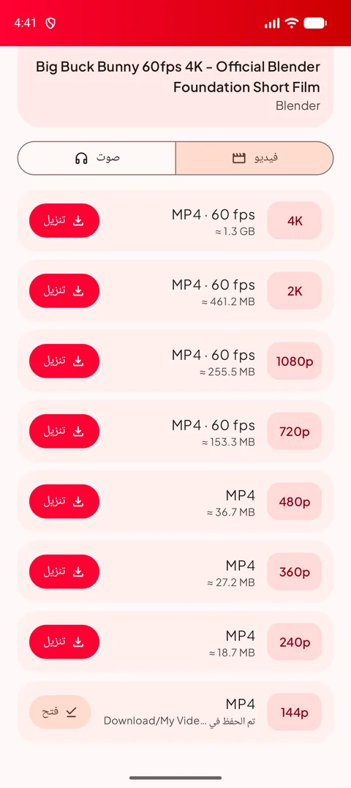
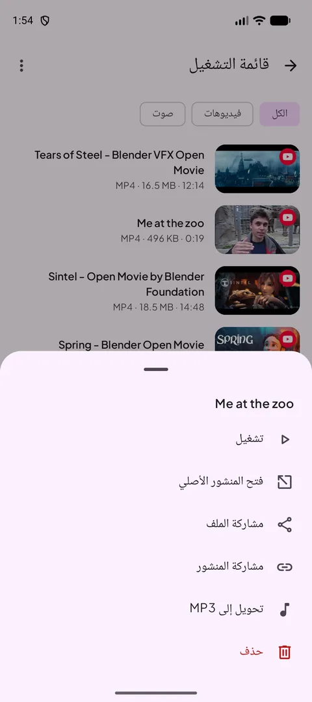
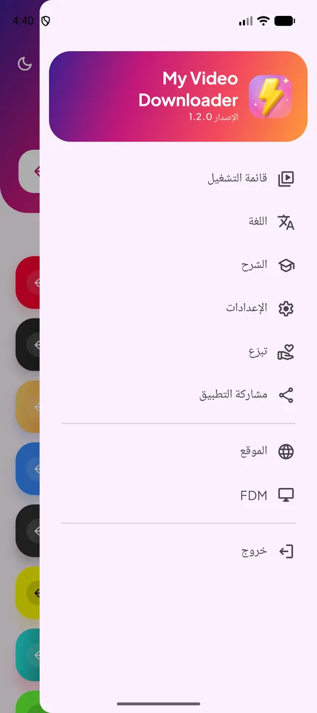
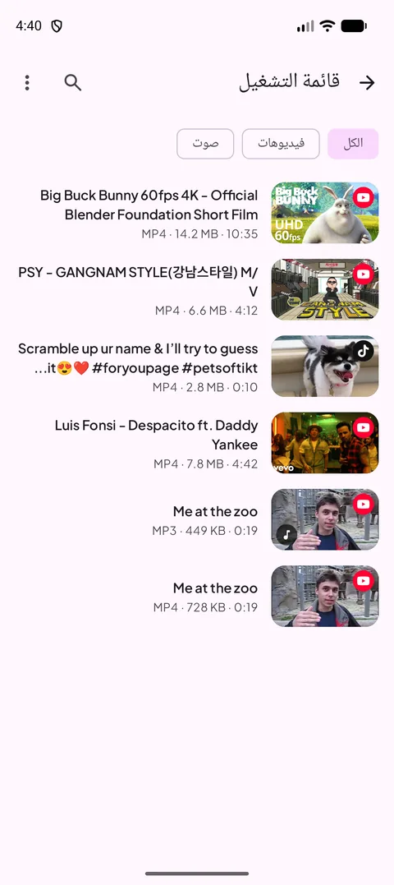
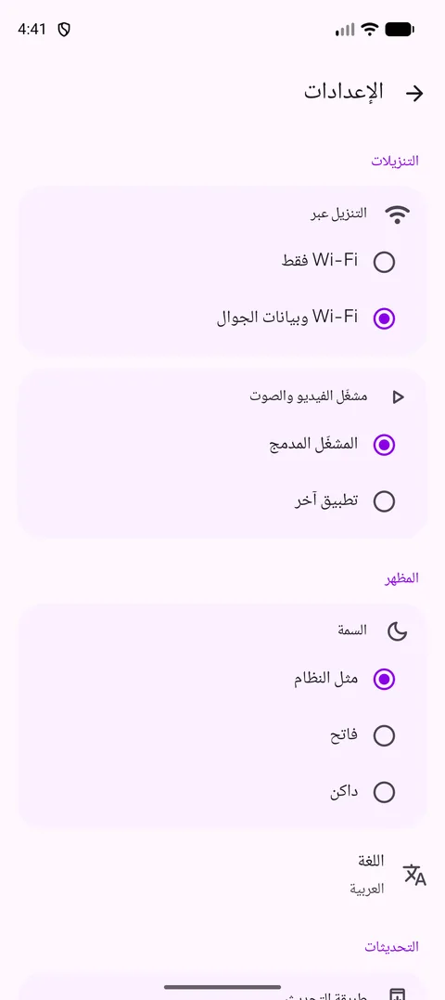
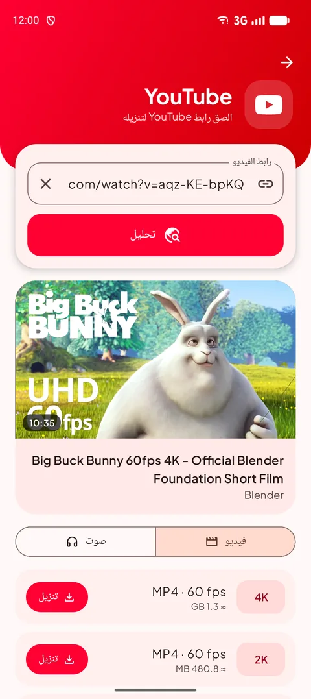
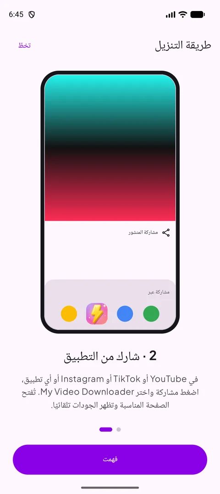
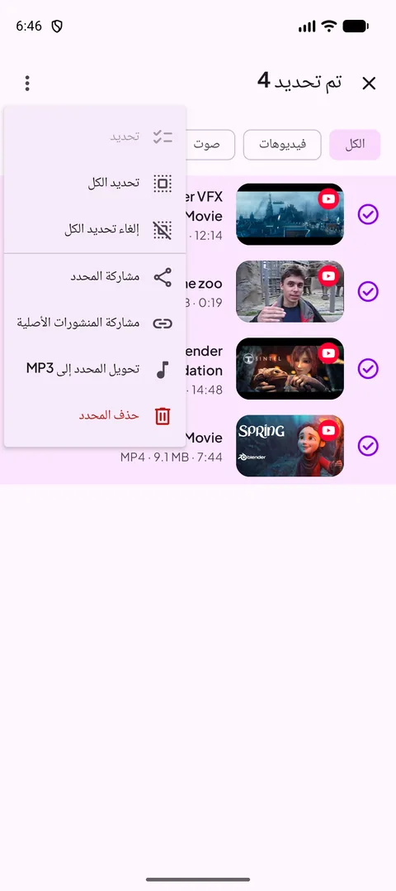
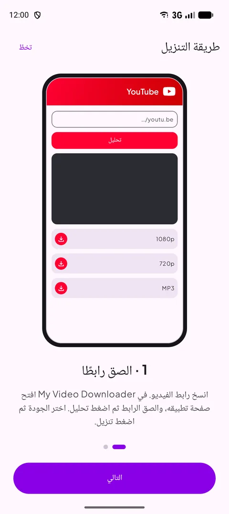

[English](README.md) · [Français](README.fr.md) · **العربية** · [中文](README.zh.md) · [日本語](README.ja.md) · [עברית](README.he.md) · [हिन्दी](README.hi.md) · [한국어](README.ko.md) · [Italiano](README.it.md) · [Português](README.pt.md) · [Español](README.es.md) · [Deutsch](README.de.md) · [Русский](README.ru.md)

### نزّل الفيديوهات والمقاطع القصيرة والقصص من تطبيقاتك المفضلة — حتى دقة 4K أو بصيغة MP3.

   

Android 12 أو أحدث · مجاني · بدون حساب

## 📸 لقطات الشاشة

<table align="center"><tr>
<td align="center" valign="top"> <b>اختر مصدرًا</b></td><td align="center" valign="top"> <b>اختر الجودة</b></td><td align="center" valign="top"> <b>إجراءات الضغط المطوّل</b></td>
</tr><tr>
<td align="center" valign="top"> <b>القائمة</b></td><td align="center" valign="top"> <b>قائمة التشغيل</b></td><td align="center" valign="top"> <b>الإعدادات</b></td>
</tr></table>

## ✨ المزايا

- **جديد في 1.1** — تحليل أسرع بكثير (يوتيوب)، تحديد متعدد في قائمة التشغيل، تقدّم التحويل إلى MP3 بالنسبة المئوية، شاشة مضاءة في المشغّل مع زر عمودي/أفقي، تنبيه Wi-Fi فقط، واللغة الروسية.
- **كل المنصات الكبرى** — YouTube وX وInstagram وFacebook وThreads وSnapchat وTikTok وKick ومعظم المواقع الأخرى.
- **حتى دقة 4K** — كل الجودات المتاحة مع عرض حجم الملف قبل التنزيل.
- **صوت فقط** — MP3 من 128 إلى 320 كيلوبت/ث، أو M4A الأصلي.
- **شارك لتنزّل** — شارك رابطًا من أي تطبيق: تُفتح الصفحة المناسبة والجودات جاهزة.
- **قائمة التشغيل** — تشغيل ومشاركة وتحويل إلى MP3 وحذف، وهي متزامنة مع مجلد Download.
- **وضع فاتح وداكن** و**13 لغة** وتنزيل عبر Wi-Fi فقط ومشغّل مدمج.
- **يعمل دائمًا** — يحدّث محرك التنزيل نفسه تلقائيًا كلما تغيّرت المواقع.

## 🌐 المواقع المدعومة

       

<i>…ومعظم المواقع التي تعرض فيديو.</i>

## 📖 طريقة التنزيل

### الطريقة 1 — لصق رابط

1. انسخ رابط الفيديو من تطبيقه (**مشاركة ← نسخ الرابط**).
2. في My Video Downloader اضغط زر المنصة، والصق الرابط ثم اضغط **تحليل**.
3. اختر جودة الفيديو أو تبويب **صوت**، ثم اضغط **تنزيل**.
4. يُحفظ الملف في **Download/My Video Downloader** ويظهر في **قائمة التشغيل**.

<table align="center"><tr>
<td align="center" valign="top"> <b>اختر مصدرًا</b></td><td align="center" valign="top"> <b>الصق ثم حلّل</b></td><td align="center" valign="top"> <b>اختر الجودة</b></td><td align="center" valign="top"> <b>قائمة التشغيل</b></td>
</tr></table>

### الطريقة 2 — المشاركة من التطبيق

1. في YouTube أو TikTok أو Instagram أو المتصفح… اضغط **مشاركة** واختر **My Video Downloader**.
2. تُفتح الصفحة المناسبة ويُحلَّل الرابط تلقائيًا.
3. اختر الجودة واضغط **تنزيل**.

<table align="center"><tr>
<td align="center" valign="top"> <b>مشاركة → My Video Downloader</b></td><td align="center" valign="top"> <b>اختر الجودة</b></td><td align="center" valign="top"> <b>شرح مدمج</b></td>
</tr></table>

> 💡 نصيحة: الحقل أعلى الشاشة الرئيسية يقبل أي رابط ويفتح الصفحة المناسبة وحده.

## 📲 التثبيت

1. نزّل ملف APK من صفحة **[Releases](https://github.com/Oussama4422/Myvideodownloader/releases/latest)**.
2. افتح الملف واسمح بالتثبيت من هذا المصدر إذا طلب Android ذلك.
3. هذا كل شيء — تُعرض التحديثات داخل التطبيق.

| الملف | لمن |
|---|---|
| [`MyVideoDownloader-vX.Y.Z-arm64-v8a.apk`](https://github.com/Oussama4422/Myvideodownloader/releases/latest) ⭐ | معظم الهواتف (موصى به) |
| [`MyVideoDownloader-vX.Y.Z-armeabi-v7a.apk`](https://github.com/Oussama4422/Myvideodownloader/releases/latest) | الهواتف القديمة 32 بت |
| [`MyVideoDownloader-vX.Y.Z-x86_64.apk`](https://github.com/Oussama4422/Myvideodownloader/releases/latest) | المحاكيات وأجهزة Chromebook |
| [`MyVideoDownloader-vX.Y.Z-universal.apk`](https://github.com/Oussama4422/Myvideodownloader/releases/latest) | كل الأجهزة (ملف أكبر) |

## 🎨 المزيد

<table align="center"><tr>
<td align="center" valign="top"> <b>قائمة التحديد</b></td><td align="center" valign="top"> <b>تحويل إلى MP3</b></td><td align="center" valign="top"> <b>المشغّل المدمج</b></td><td align="center" valign="top"> <b>تنبيه Wi-Fi فقط</b></td>
</tr><tr>
<td align="center" valign="top"> <b>الوضع الداكن</b></td><td align="center" valign="top"> <b>تحويل إلى MP3</b></td><td align="center" valign="top"> <b>شرح مدمج</b></td><td align="center" valign="top"> <b>ادعم المشروع</b></td>
</tr></table>

## 🌍 متوفر بـ 13 لغة

يتبع التطبيق لغة هاتفك تلقائيًا (الإنجليزية افتراضيًا)، ويمكنك تغييرها من القائمة.

<table align="center"><tr>
<td align="center"> English</td>
<td align="center"> Français</td>
<td align="center"> العربية</td>
<td align="center"> 中文</td>
<td align="center"> 日本語</td>
<td align="center"> עברית</td>
<td align="center"> हिन्दी</td>
</tr><tr>
<td align="center"> 한국어</td>
<td align="center"> Italiano</td>
<td align="center"> Português</td>
<td align="center"> Español</td>
<td align="center"> Deutsch</td>
<td align="center"> Русский</td>
</tr></table>

## ❓ الأسئلة الشائعة

<b>هل التطبيق مجاني؟</b>

نعم. بدون حساب وبدون اشتراك.

<b>أي ملف APK أختار؟</b>

**arm64-v8a** يعمل على معظم الهواتف بنظام Android 12 أو أحدث. إذا لم يُثبَّت، اختر **universal**.

<b>لماذا ليس على Google Play؟</b>

لا يسمح Google Play بالتطبيقات التي تنزّل فيديوهات YouTube، لذلك يُوزَّع التطبيق هنا وعلى videodownloader.my.

<b>هل يمكنني تنزيل الفيديوهات أو القصص الخاصة؟</b>

المحتوى العام فقط. لا يمكن تنزيل المنشورات الخاصة والقصص التي تتطلب حسابًا.

<b>أين ملفاتي؟</b>

في مجلد **Download/My Video Downloader** على هاتفك، وفي **قائمة التشغيل** داخل التطبيق.

## 💜 ادعم المشروع

My Video Downloader مجاني. إذا كان مفيدًا لك، يمكنك دعم تطويره:

 PayPal — أرسل إلى عنوان البريد هذا: <code>elsouad212@gmail.com</code>

 <b>Bitcoin (BTC)</b> <code>bc1qv7h60rf3yrcq2lgdqd9m74ezltchzxvw7lfcgd</code>

## 🔗 روابط

- 🌐 الموقع — https://videodownloader.my
- 🖥️ File Download Manager لنظام Windows — https://filedownloadmanager.com/

---

نزّل فقط المحتوى الذي يحق لك حفظه. أسماء المنصات وشعاراتها ملك لأصحابها.

