

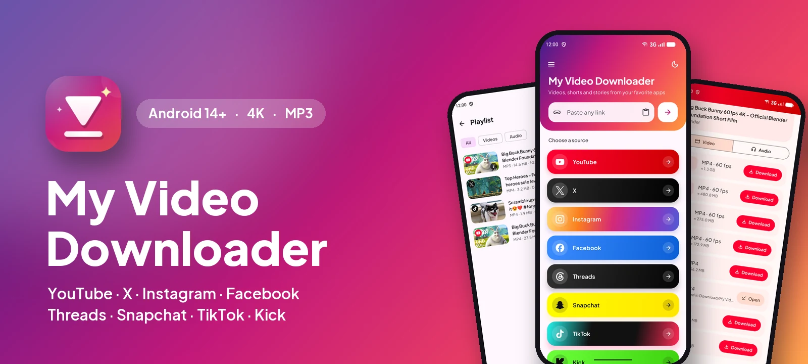

[English](README.md) · [Français](README.fr.md) · [العربية](README.ar.md) · [中文](README.zh.md) · [日本語](README.ja.md) · [עברית](README.he.md) · [हिन्दी](README.hi.md) · [한국어](README.ko.md) · [Italiano](README.it.md) · [Português](README.pt.md) · [Español](README.es.md) · **Deutsch** · [Русский](README.ru.md)

### Lade Videos, Shorts und Storys aus deinen Lieblings-Apps herunter — bis 4K oder als MP3.

   

Android 12 oder neuer · kostenlos · ohne Konto

## 📸 Screenshots

<table align="center"><tr>
<td align="center" valign="top">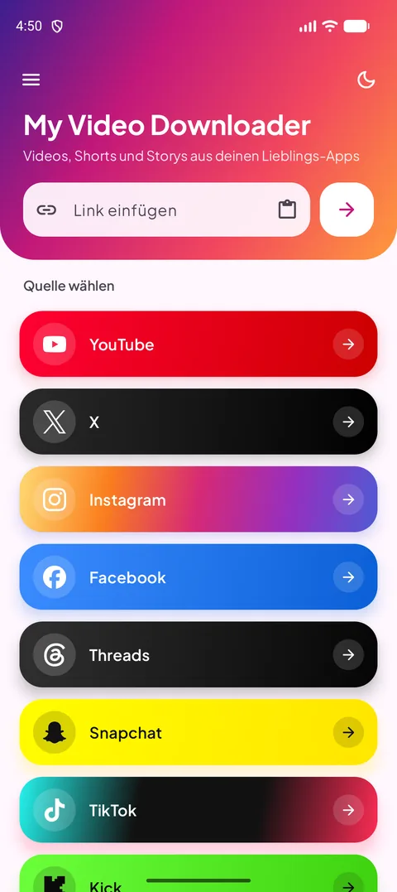 <b>Quelle wählen</b></td><td align="center" valign="top">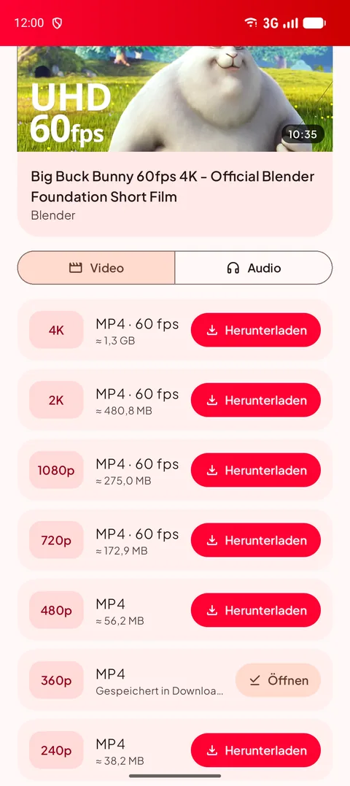 <b>Qualität wählen</b></td><td align="center" valign="top">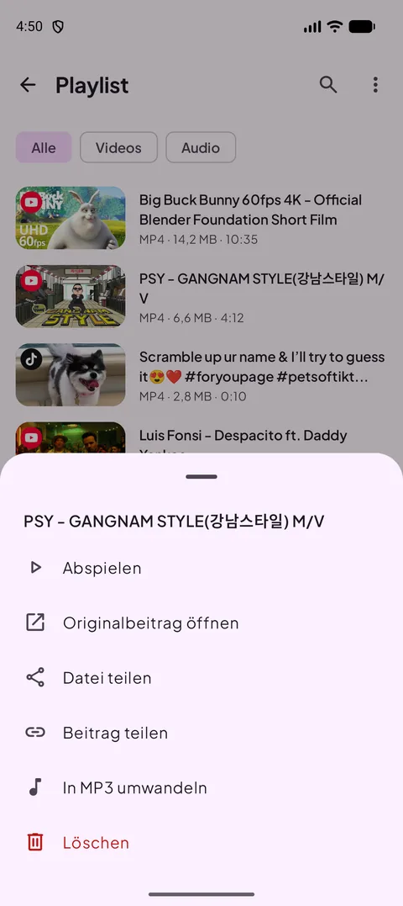 <b>Aktionen per langem Tippen</b></td>
</tr><tr>
<td align="center" valign="top">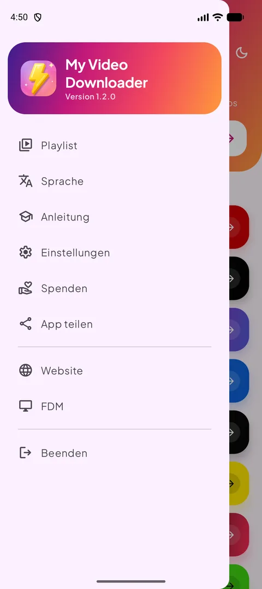 <b>Menü</b></td><td align="center" valign="top">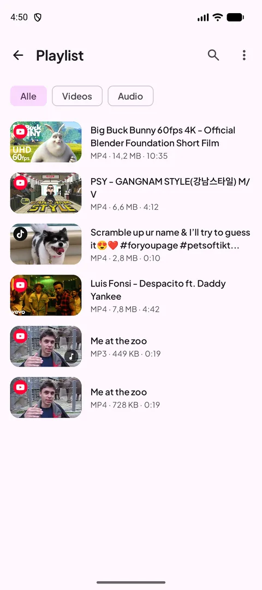 <b>Deine Playlist</b></td><td align="center" valign="top">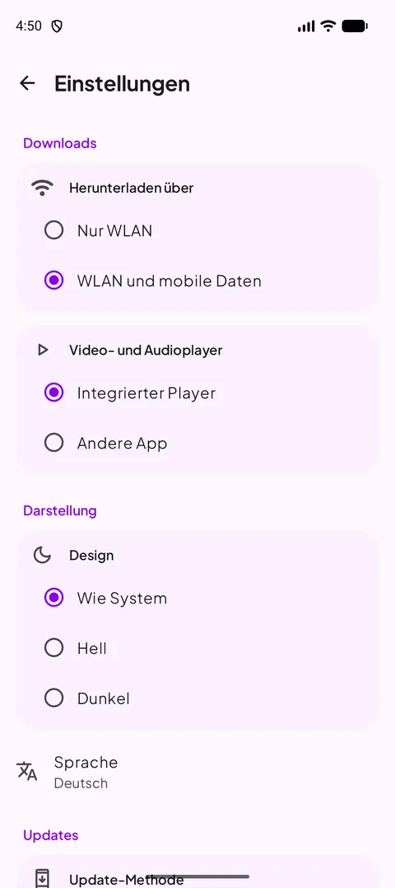 <b>Einstellungen</b></td>
</tr></table>

## ✨ Funktionen

- **Neu in 1.1** — deutlich schnellere Analyse (YouTube), Mehrfachauswahl in der Playlist, MP3-Fortschritt in %, Bildschirm bleibt im Player an, Hoch-/Querformat-Knopf, Hinweis „Nur WLAN“ und Russisch.
- **Alle großen Plattformen** — YouTube, X, Instagram, Facebook, Threads, Snapchat, TikTok, Kick und die meisten anderen Websites.
- **Bis 4K** — alle verfügbaren Qualitäten, mit der Dateigröße vor dem Download.
- **Nur Audio** — MP3 mit 128 bis 320 kbit/s oder das originale M4A.
- **Teilen zum Herunterladen** — teile einen Link aus jeder App: die passende Seite öffnet sich mit den Qualitäten.
- **Playlist** — abspielen, teilen, in MP3 umwandeln oder löschen; sie bleibt mit deinem Download-Ordner synchron.
- **Heller und dunkler Modus**, **13 Sprachen**, Downloads nur über WLAN und integrierter Player.
- **Funktioniert immer** — die Download-Engine aktualisiert sich selbst, wenn sich Websites ändern.

## 🌐 Unterstützte Seiten

       

<i>…und die meisten Websites, die ein Video zeigen.</i>

## 📖 So lädst du herunter

### Methode 1 — Link einfügen

1. Kopiere den Link des Videos in seiner App (**Teilen → Link kopieren**).
2. Tippe in My Video Downloader auf die Schaltfläche der Plattform, füge den Link ein und tippe auf **Analysieren**.
3. Wähle eine Videoqualität oder den Tab **Audio** und tippe auf **Herunterladen**.
4. Die Datei wird unter **Download/My Video Downloader** gespeichert und erscheint in der **Playlist**.

<table align="center"><tr>
<td align="center" valign="top"> <b>Quelle wählen</b></td><td align="center" valign="top">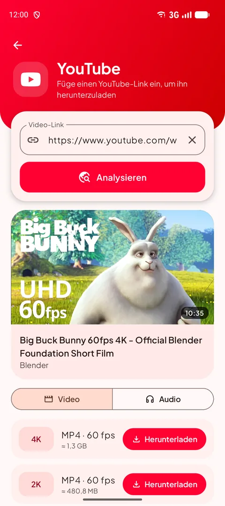 <b>Einfügen und analysieren</b></td><td align="center" valign="top"> <b>Qualität wählen</b></td><td align="center" valign="top"> <b>Deine Playlist</b></td>
</tr></table>

### Methode 2 — Aus der App teilen

1. Tippe in YouTube, TikTok, Instagram oder deinem Browser auf **Teilen** und wähle **My Video Downloader**.
2. Die passende Seite öffnet sich und der Link wird automatisch analysiert.
3. Wähle eine Qualität und tippe auf **Herunterladen**.

<table align="center"><tr>
<td align="center" valign="top">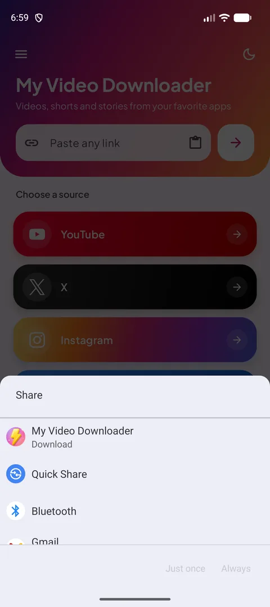 <b>Teilen → My Video Downloader</b></td><td align="center" valign="top"> <b>Qualität wählen</b></td><td align="center" valign="top">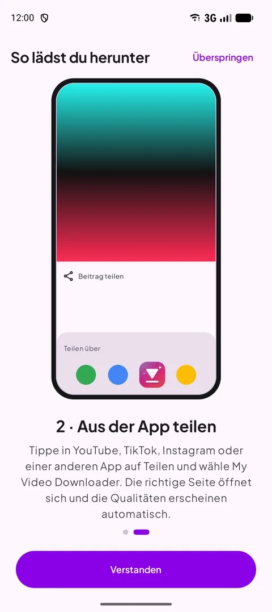 <b>Integrierte Anleitung</b></td>
</tr></table>

> 💡 Tipp: Das Feld oben auf dem Startbildschirm nimmt jeden Link an und öffnet selbst die passende Seite.

## 📲 Installation

1. Lade die APK auf der Seite **[Releases](https://github.com/Oussama4422/Myvideodownloader/releases/latest)** herunter.
2. Öffne die Datei und erlaube die Installation aus dieser Quelle, wenn Android fragt.
3. Fertig — Updates werden in der App angeboten.

| Datei | Für |
|---|---|
| [`MyVideoDownloader-vX.Y.Z-arm64-v8a.apk`](https://github.com/Oussama4422/Myvideodownloader/releases/latest) ⭐ | Die meisten Handys (empfohlen) |
| [`MyVideoDownloader-vX.Y.Z-armeabi-v7a.apk`](https://github.com/Oussama4422/Myvideodownloader/releases/latest) | Ältere 32-Bit-Handys |
| [`MyVideoDownloader-vX.Y.Z-x86_64.apk`](https://github.com/Oussama4422/Myvideodownloader/releases/latest) | Emulatoren, Chromebooks |
| [`MyVideoDownloader-vX.Y.Z-universal.apk`](https://github.com/Oussama4422/Myvideodownloader/releases/latest) | Jedes Gerät (größere Datei) |

## 🎨 Mehr

<table align="center"><tr>
<td align="center" valign="top">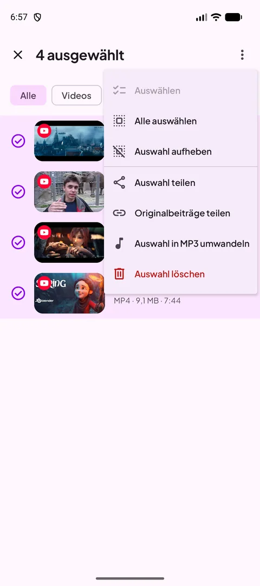 <b>Auswahlmenü</b></td><td align="center" valign="top">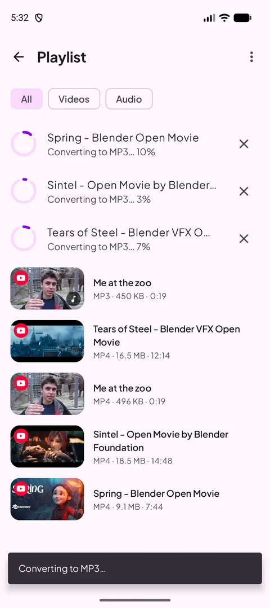 <b>In MP3 umwandeln</b></td><td align="center" valign="top">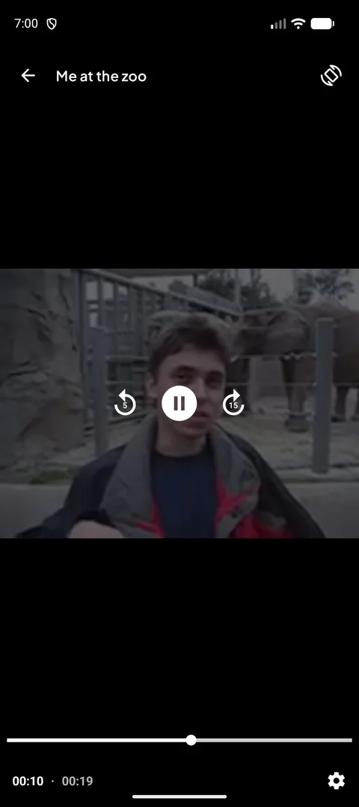 <b>Integrierter Player</b></td><td align="center" valign="top">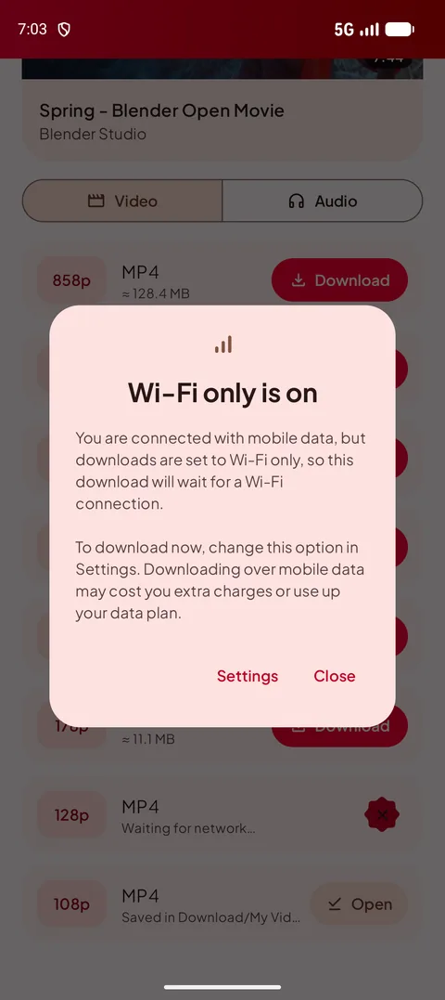 <b>Hinweis „Nur WLAN“</b></td>
</tr><tr>
<td align="center" valign="top">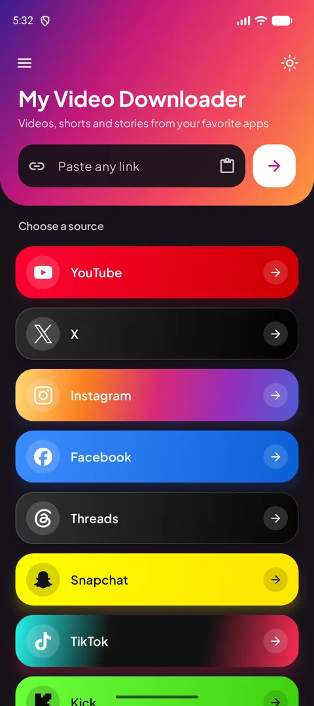 <b>Dunkler Modus</b></td><td align="center" valign="top">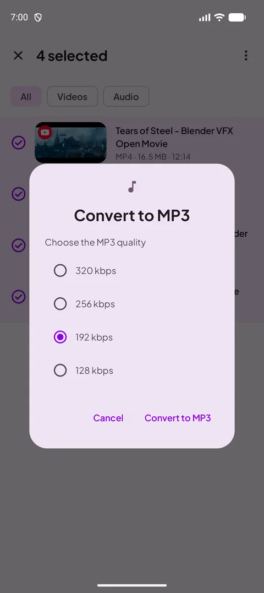 <b>In MP3 umwandeln</b></td><td align="center" valign="top">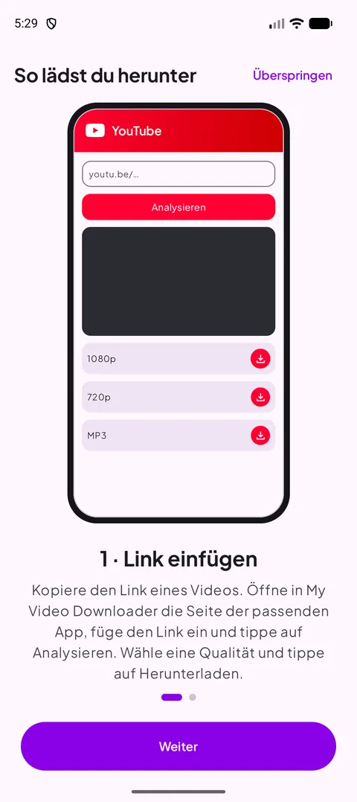 <b>Integrierte Anleitung</b></td><td align="center" valign="top">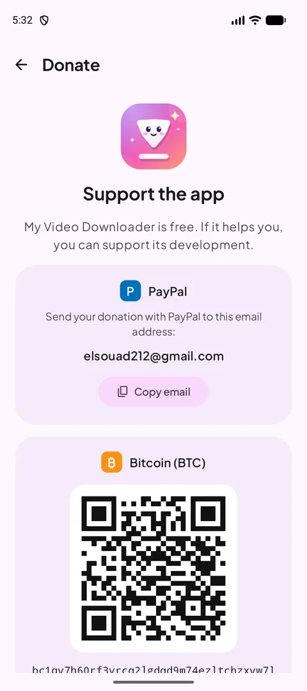 <b>Projekt unterstützen</b></td>
</tr></table>

## 🌍 Verfügbar in 13 Sprachen

Die App folgt automatisch der Sprache deines Handys (Standard: Englisch). Du kannst sie auch im Menü ändern.

<table align="center"><tr>
<td align="center"> English</td>
<td align="center"><a href="README.fr.md">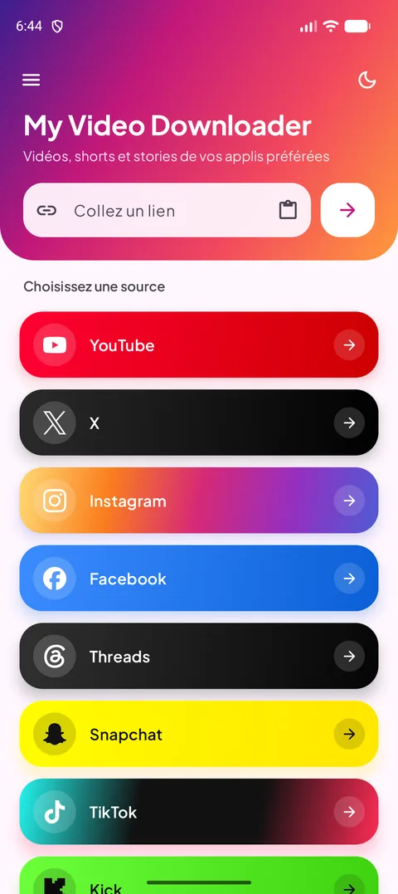</a> Français</td>
<td align="center"><a href="README.ar.md">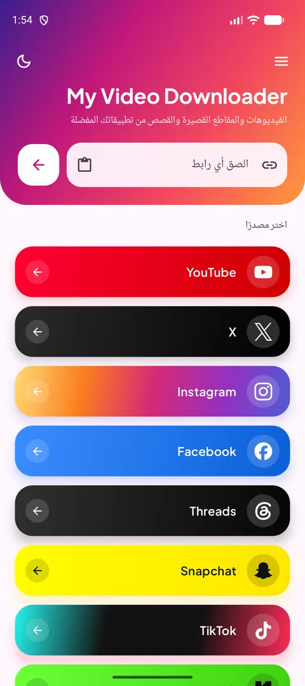</a> العربية</td>
<td align="center"><a href="README.zh.md">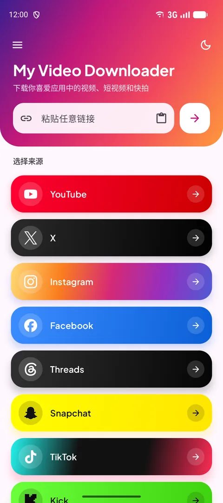</a> 中文</td>
<td align="center"> 日本語</td>
<td align="center"><a href="README.he.md">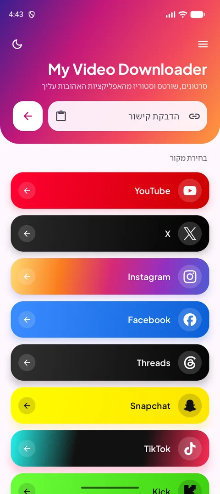</a> עברית</td>
<td align="center"> हिन्दी</td>
</tr><tr>
<td align="center"> 한국어</td>
<td align="center"> Italiano</td>
<td align="center"><a href="README.pt.md">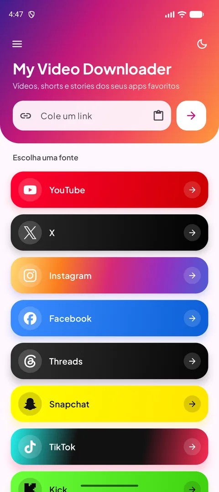</a> Português</td>
<td align="center"> Español</td>
<td align="center"> Deutsch</td>
<td align="center"><a href="README.ru.md">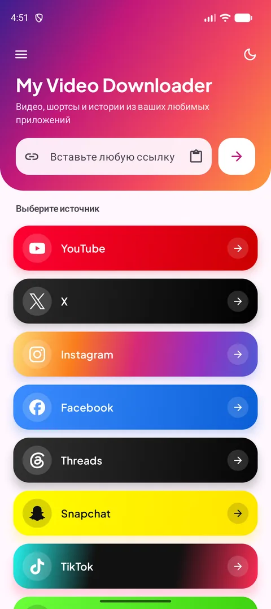</a> Русский</td>
</tr></table>

## ❓ Häufige Fragen

<b>Ist sie kostenlos?</b>

Ja. Kein Konto, kein Abo.

<b>Welche APK soll ich nehmen?</b>

**arm64-v8a** läuft auf fast allen Handys mit Android 12 oder neuer. Wenn sie sich nicht installieren lässt, nimm **universal**.

<b>Warum ist sie nicht bei Google Play?</b>

Google Play erlaubt keine Apps, die YouTube-Videos herunterladen. Daher wird die App hier und auf videodownloader.my verteilt.

<b>Kann ich private Videos oder Storys herunterladen?</b>

Nur öffentliche Inhalte. Private Beiträge und Storys, die ein Konto erfordern, lassen sich nicht herunterladen.

<b>Wo sind meine Dateien?</b>

Im Ordner **Download/My Video Downloader** deines Handys und in der **Playlist** der App.

## 💜 Projekt unterstützen

My Video Downloader ist kostenlos. Wenn sie dir hilft, kannst du ihre Entwicklung unterstützen:

 PayPal — an diese E-Mail-Adresse senden: <code>elsouad212@gmail.com</code>

 <b>Bitcoin (BTC)</b> <code>bc1qv7h60rf3yrcq2lgdqd9m74ezltchzxvw7lfcgd</code>

## 🔗 Links

- 🌐 Website — https://videodownloader.my
- 🖥️ File Download Manager für Windows — https://filedownloadmanager.com/

---

Lade nur Inhalte herunter, die du speichern darfst. Namen und Logos der Plattformen gehören ihren Inhabern.
