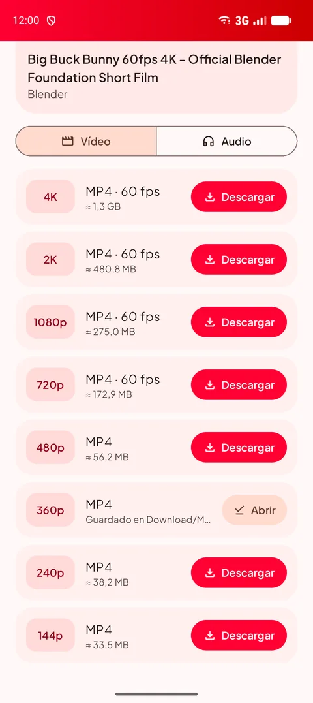
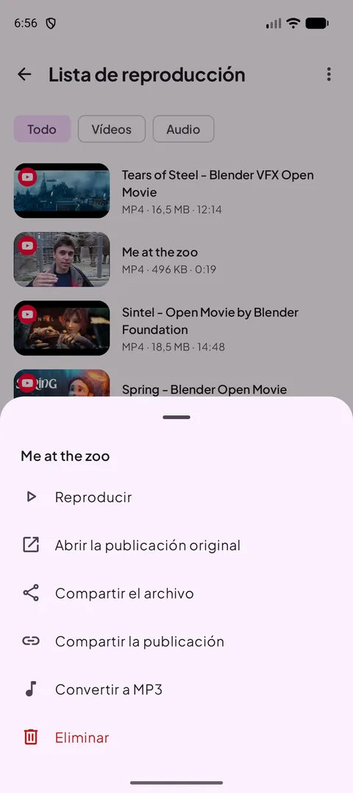
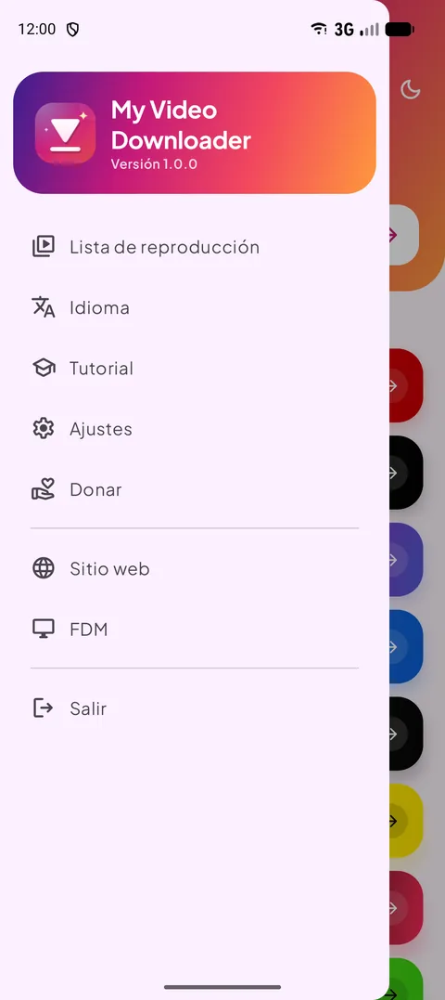
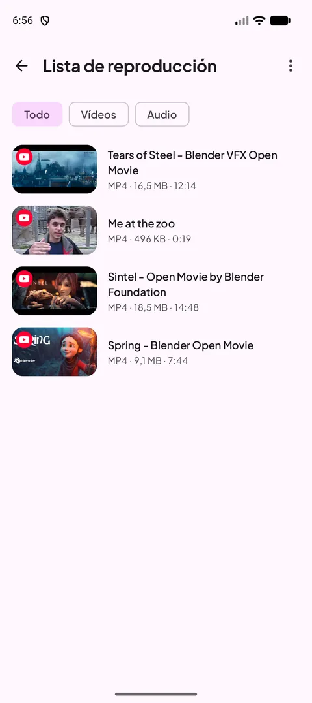
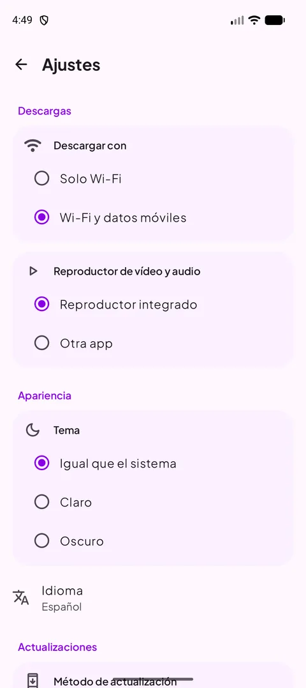
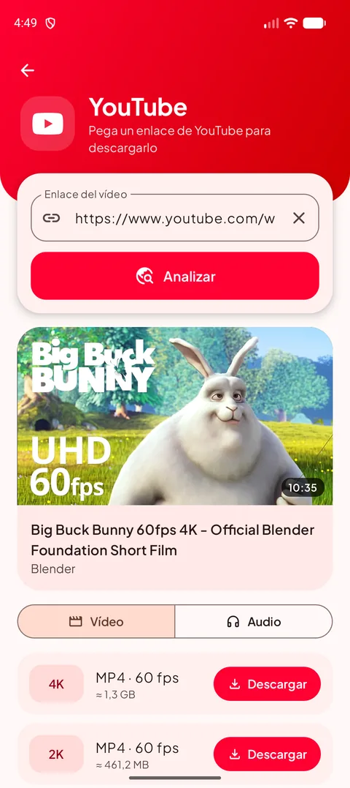
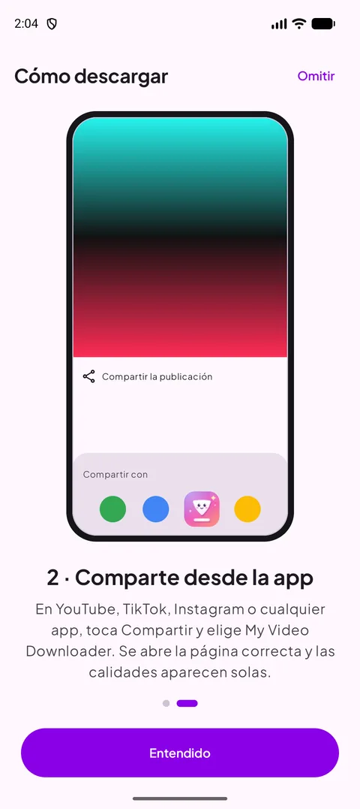
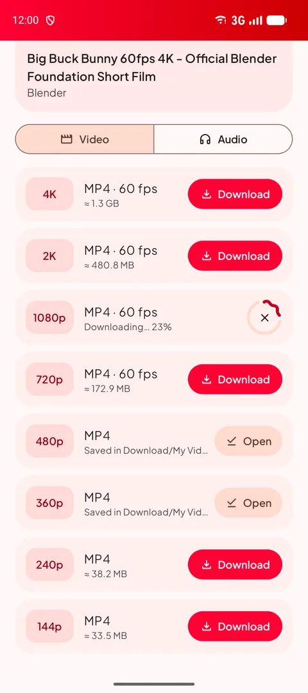
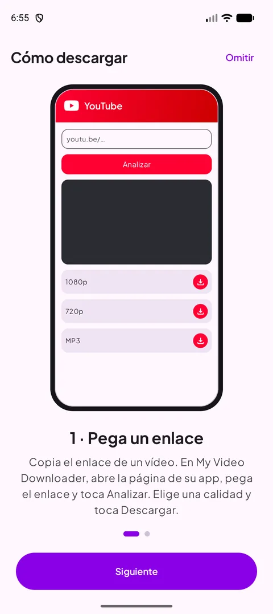

[English](README.md) · [Français](README.fr.md) · [العربية](README.ar.md) · [中文](README.zh.md) · [日本語](README.ja.md) · [עברית](README.he.md) · [हिन्दी](README.hi.md) · [한국어](README.ko.md) · [Italiano](README.it.md) · [Português](README.pt.md) · **Español** · [Deutsch](README.de.md)

### Descarga vídeos, shorts e historias de tus apps favoritas — hasta 4K, o en MP3.

   

Android 14 o posterior · gratis · sin cuenta

## 📸 Capturas de pantalla

<table align="center"><tr>
<td align="center" valign="top"> <b>Elige una fuente</b></td><td align="center" valign="top"> <b>Elige la calidad</b></td><td align="center" valign="top"> <b>Acciones al mantener pulsado</b></td>
</tr><tr>
<td align="center" valign="top"> <b>Menú</b></td><td align="center" valign="top"> <b>Tu lista</b></td><td align="center" valign="top"> <b>Ajustes</b></td>
</tr></table>

## ✨ Funciones

- **Todas las grandes plataformas** — YouTube, X, Instagram, Facebook, Threads, Snapchat, TikTok, Kick y la mayoría de los demás sitios.
- **Hasta 4K** — todas las calidades disponibles, con el tamaño del archivo antes de descargar.
- **Solo audio** — MP3 de 128 a 320 kbps, o el M4A original.
- **Comparte para descargar** — comparte un enlace desde cualquier app: se abre la página correcta con las calidades listas.
- **Lista de reproducción** — reproduce, comparte, convierte a MP3 o elimina; se mantiene sincronizada con tu carpeta Download.
- **Modo claro y oscuro**, **12 idiomas**, descargas solo con Wi-Fi y reproductor integrado.
- **Siempre funciona** — el motor de descarga se actualiza solo cuando los sitios cambian.

## 🌐 Sitios compatibles

       

<i>…y la mayoría de los sitios que muestran un vídeo.</i>

## 📖 Cómo descargar

### Método 1 — Pega un enlace

1. Copia el enlace del vídeo en su app (**Compartir → Copiar enlace**).
2. En My Video Downloader, toca el botón de la plataforma, pega el enlace y toca **Analizar**.
3. Elige una calidad de vídeo o la pestaña **Audio** y toca **Descargar**.
4. El archivo se guarda en **Download/My Video Downloader** y aparece en la **lista de reproducción**.

<table align="center"><tr>
<td align="center" valign="top"> <b>Elige una fuente</b></td><td align="center" valign="top"> <b>Pegar y analizar</b></td><td align="center" valign="top"> <b>Elige la calidad</b></td><td align="center" valign="top"> <b>Tu lista</b></td>
</tr></table>

### Método 2 — Comparte desde la app

1. En YouTube, TikTok, Instagram, tu navegador… toca **Compartir** y elige **My Video Downloader**.
2. Se abre la página correcta y el enlace se analiza automáticamente.
3. Elige una calidad y toca **Descargar**.

<table align="center"><tr>
<td align="center" valign="top"> <b>Compartir → My Video Downloader</b></td><td align="center" valign="top"> <b>Elige la calidad</b></td><td align="center" valign="top"> <b>Tutorial integrado</b></td>
</tr></table>

> 💡 Consejo: el campo de la parte superior de la pantalla de inicio acepta cualquier enlace y abre sola la página correcta.

## 📲 Instalación

1. Descarga el APK desde la página **[Releases](https://github.com/Oussama4422/Myvideodownloader/releases/latest)**.
2. Abre el archivo y permite instalar desde esta fuente si Android lo pide.
3. Listo — las actualizaciones se ofrecen dentro de la app.

| Archivo | Para |
|---|---|
| [`MyVideoDownloader-vX.Y.Z-arm64-v8a.apk`](https://github.com/Oussama4422/Myvideodownloader/releases/latest) ⭐ | La mayoría de los teléfonos (recomendado) |
| [`MyVideoDownloader-vX.Y.Z-armeabi-v7a.apk`](https://github.com/Oussama4422/Myvideodownloader/releases/latest) | Teléfonos antiguos de 32 bits |
| [`MyVideoDownloader-vX.Y.Z-x86_64.apk`](https://github.com/Oussama4422/Myvideodownloader/releases/latest) | Emuladores, Chromebooks |
| [`MyVideoDownloader-vX.Y.Z-universal.apk`](https://github.com/Oussama4422/Myvideodownloader/releases/latest) | Cualquier dispositivo (archivo más grande) |

## 🎨 Más

<table align="center"><tr>
<td align="center" valign="top"> <b>Modo oscuro</b></td><td align="center" valign="top"> <b>Descargando</b></td><td align="center" valign="top"> <b>Convertir a MP3</b></td><td align="center" valign="top"> <b>Tutorial integrado</b></td>
</tr></table>

## 🌍 Disponible en 12 idiomas

La app sigue automáticamente el idioma de tu teléfono (inglés por defecto). También puedes cambiarlo desde el menú.

<table align="center"><tr>
<td align="center"> English</td>
<td align="center"> Français</td>
<td align="center"> العربية</td>
<td align="center"> 中文</td>
<td align="center"> 日本語</td>
<td align="center"> עברית</td>
</tr><tr>
<td align="center"> हिन्दी</td>
<td align="center"> 한국어</td>
<td align="center"> Italiano</td>
<td align="center"> Português</td>
<td align="center"> Español</td>
<td align="center"> Deutsch</td>
</tr></table>

## ❓ Preguntas frecuentes

<b>¿Es gratis?</b>

Sí. Sin cuenta y sin suscripción.

<b>¿Qué APK elijo?</b>

**arm64-v8a** funciona en casi todos los teléfonos con Android 14 o posterior. Si no se instala, elige **universal**.

<b>¿Por qué no está en Google Play?</b>

Google Play no permite apps que descargan vídeos de YouTube, así que la app se distribuye aquí y en videodownloader.my.

<b>¿Puedo descargar vídeos o historias privadas?</b>

Solo contenido público. Las publicaciones privadas y las historias que requieren cuenta no se pueden descargar.

<b>¿Dónde están mis archivos?</b>

En la carpeta **Download/My Video Downloader** de tu teléfono y en la **lista de reproducción** de la app.

## 💜 Apoya el proyecto

My Video Downloader es gratuita. Si te resulta útil, puedes apoyar su desarrollo:

 <b>Bitcoin (BTC)</b> <code>bc1qv7h60rf3yrcq2lgdqd9m74ezltchzxvw7lfcgd</code>

## 🔗 Enlaces

- 🌐 Sitio web — https://videodownloader.my
- 🖥️ File Download Manager para Windows — https://filedownloadmanager.com/

---

Descarga solo contenido que tengas derecho a guardar. Los nombres y logotipos de las plataformas pertenecen a sus propietarios.
