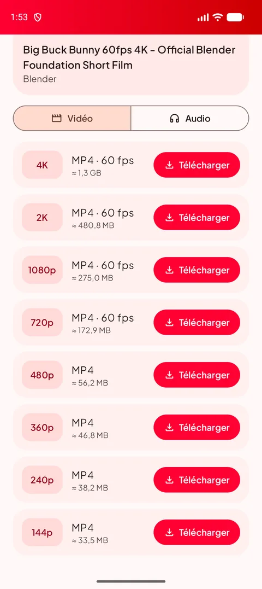
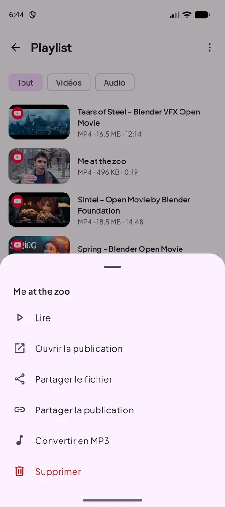
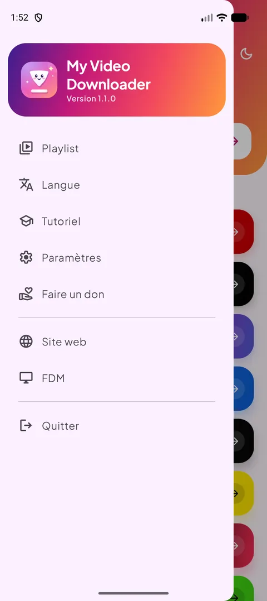
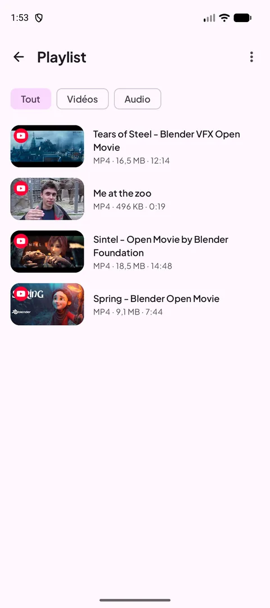
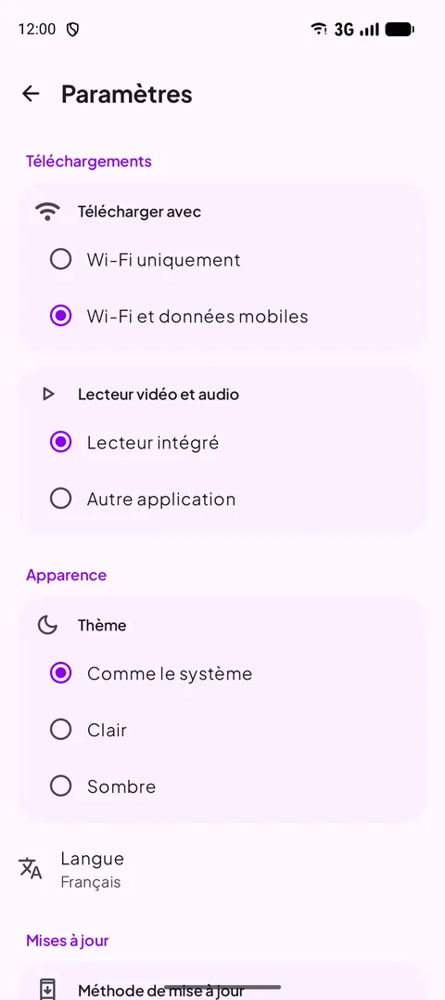
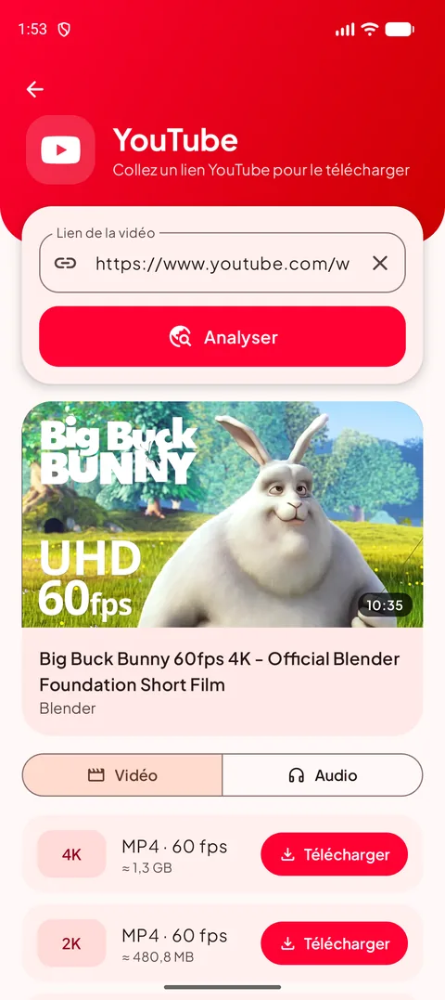
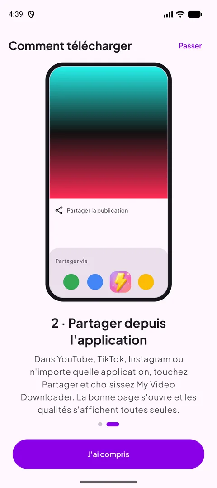
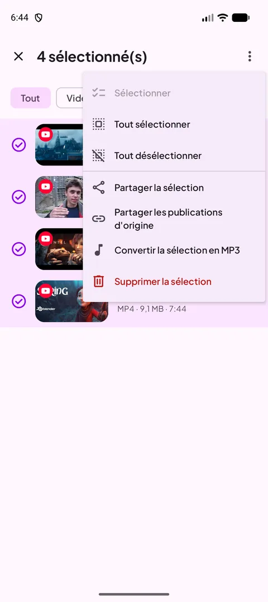
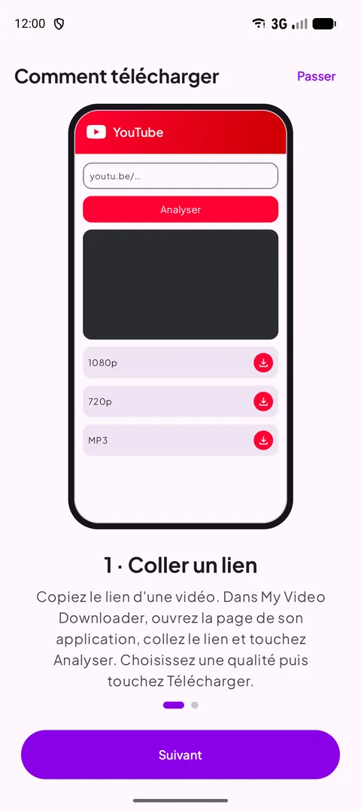

[English](README.md) · **Français** · [العربية](README.ar.md) · [中文](README.zh.md) · [日本語](README.ja.md) · [עברית](README.he.md) · [हिन्दी](README.hi.md) · [한국어](README.ko.md) · [Italiano](README.it.md) · [Português](README.pt.md) · [Español](README.es.md) · [Deutsch](README.de.md) · [Русский](README.ru.md)

### Téléchargez les vidéos, shorts et stories de vos applis préférées — jusqu'en 4K, ou en MP3.

   

Android 12 ou plus récent · gratuit · sans compte

## 📸 Captures d'écran

<table align="center"><tr>
<td align="center" valign="top"> <b>Choisir une source</b></td><td align="center" valign="top"> <b>Choisir une qualité</b></td><td align="center" valign="top"> <b>Actions à l'appui long</b></td>
</tr><tr>
<td align="center" valign="top"> <b>Menu</b></td><td align="center" valign="top"> <b>Votre playlist</b></td><td align="center" valign="top"> <b>Paramètres</b></td>
</tr></table>

## ✨ Fonctionnalités

- **Nouveau en 1.2** — analyse des liens environ deux fois plus rapide sur tous les sites, titre et image de la vidéo affichés tout de suite, recherche dans la playlist et bouton « Partager l'application » dans le menu.
- **Nouveau en 1.1** — analyse bien plus rapide (YouTube), sélection multiple dans la playlist, progression MP3 en %, écran toujours allumé dans le lecteur avec bouton portrait/paysage, alerte Wi-Fi uniquement et russe.
- **Toutes les grandes plateformes** — YouTube, X, Instagram, Facebook, Threads, Snapchat, TikTok, Kick et la plupart des autres sites.
- **Jusqu'en 4K** — toutes les qualités disponibles, avec la taille du fichier affichée avant de télécharger.
- **Audio seul** — MP3 de 128 à 320 kbit/s, ou M4A d'origine.
- **Partager pour télécharger** — partagez un lien depuis n'importe quelle appli : la bonne page s'ouvre, qualités prêtes.
- **Playlist** — lire, partager, convertir en MP3 ou supprimer ; elle reste synchronisée avec votre dossier Download.
- **Mode clair et sombre**, **13 langues**, téléchargement en Wi-Fi seul et lecteur intégré.
- **Toujours fonctionnelle** — le moteur de téléchargement se met à jour tout seul quand les sites changent.

## 🌐 Sites pris en charge

       

<i>…et la plupart des sites qui affichent une vidéo.</i>

## 📖 Comment télécharger

### Méthode 1 — Coller un lien

1. Copiez le lien de la vidéo dans son appli (**Partager → Copier le lien**).
2. Dans My Video Downloader, touchez le bouton de la plateforme, collez le lien et touchez **Analyser**.
3. Choisissez une qualité vidéo ou l'onglet **Audio**, puis touchez **Télécharger**.
4. Le fichier est enregistré dans **Download/My Video Downloader** et apparaît dans la **Playlist**.

<table align="center"><tr>
<td align="center" valign="top"> <b>Choisir une source</b></td><td align="center" valign="top"> <b>Coller et analyser</b></td><td align="center" valign="top"> <b>Choisir une qualité</b></td><td align="center" valign="top"> <b>Votre playlist</b></td>
</tr></table>

### Méthode 2 — Partager depuis l'appli

1. Dans YouTube, TikTok, Instagram, votre navigateur… touchez **Partager** et choisissez **My Video Downloader**.
2. La bonne page s'ouvre et le lien est analysé automatiquement.
3. Choisissez une qualité et touchez **Télécharger**.

<table align="center"><tr>
<td align="center" valign="top"> <b>Partager → My Video Downloader</b></td><td align="center" valign="top"> <b>Choisir une qualité</b></td><td align="center" valign="top"> <b>Tutoriel intégré</b></td>
</tr></table>

> 💡 Astuce : le champ en haut de l'accueil accepte n'importe quel lien et ouvre tout seul la bonne page.

## 📲 Installation

1. Téléchargez l'APK depuis la page **[Releases](https://github.com/Oussama4422/Myvideodownloader/releases/latest)**.
2. Ouvrez le fichier et autorisez l'installation depuis cette source si Android le demande.
3. C'est tout — les mises à jour sont proposées dans l'appli.

| Fichier | Pour |
|---|---|
| [`MyVideoDownloader-vX.Y.Z-arm64-v8a.apk`](https://github.com/Oussama4422/Myvideodownloader/releases/latest) ⭐ | La plupart des téléphones (recommandé) |
| [`MyVideoDownloader-vX.Y.Z-armeabi-v7a.apk`](https://github.com/Oussama4422/Myvideodownloader/releases/latest) | Anciens téléphones 32 bits |
| [`MyVideoDownloader-vX.Y.Z-x86_64.apk`](https://github.com/Oussama4422/Myvideodownloader/releases/latest) | Émulateurs, Chromebooks |
| [`MyVideoDownloader-vX.Y.Z-universal.apk`](https://github.com/Oussama4422/Myvideodownloader/releases/latest) | Tous les appareils (fichier plus lourd) |

## 🎨 Plus

<table align="center"><tr>
<td align="center" valign="top"> <b>Menu de sélection</b></td><td align="center" valign="top"> <b>Convertir en MP3</b></td><td align="center" valign="top"> <b>Lecteur intégré</b></td><td align="center" valign="top"> <b>Alerte Wi-Fi uniquement</b></td>
</tr><tr>
<td align="center" valign="top"> <b>Mode sombre</b></td><td align="center" valign="top"> <b>Convertir en MP3</b></td><td align="center" valign="top"> <b>Tutoriel intégré</b></td><td align="center" valign="top"> <b>Soutenir le projet</b></td>
</tr></table>

## 🌍 Disponible en 13 langues

L'appli suit automatiquement la langue de votre téléphone (anglais par défaut). Vous pouvez aussi la changer depuis le menu.

<table align="center"><tr>
<td align="center"> English</td>
<td align="center"> Français</td>
<td align="center"> العربية</td>
<td align="center"> 中文</td>
<td align="center"> 日本語</td>
<td align="center"> עברית</td>
<td align="center"> हिन्दी</td>
</tr><tr>
<td align="center"> 한국어</td>
<td align="center"> Italiano</td>
<td align="center"> Português</td>
<td align="center"> Español</td>
<td align="center"> Deutsch</td>
<td align="center"> Русский</td>
</tr></table>

## ❓ Questions fréquentes

<b>C'est gratuit ?</b>

Oui. Pas de compte, pas d'abonnement.

<b>Quel APK choisir ?</b>

**arm64-v8a** fonctionne sur presque tous les téléphones sous Android 12 ou plus. S'il ne s'installe pas, prenez **universal**.

<b>Pourquoi elle n'est pas sur Google Play ?</b>

Google Play interdit les applis qui téléchargent des vidéos YouTube : l'appli est donc distribuée ici et sur videodownloader.my.

<b>Puis-je télécharger des vidéos ou stories privées ?</b>

Seulement les contenus publics. Les publications privées et les stories qui demandent un compte ne sont pas téléchargeables.

<b>Où sont mes fichiers ?</b>

Dans le dossier **Download/My Video Downloader** de votre téléphone, et dans la **Playlist** de l'appli.

## 💜 Soutenir le projet

My Video Downloader est gratuite. Si elle vous est utile, vous pouvez soutenir son développement :

 PayPal — envoyez à cette adresse e-mail : <code>elsouad212@gmail.com</code>

 <b>Bitcoin (BTC)</b> <code>bc1qv7h60rf3yrcq2lgdqd9m74ezltchzxvw7lfcgd</code>

## 🔗 Liens

- 🌐 Site web — https://videodownloader.my
- 🖥️ File Download Manager pour Windows — https://filedownloadmanager.com/

---

Téléchargez uniquement des contenus que vous avez le droit d'enregistrer. Les noms et logos des plateformes appartiennent à leurs propriétaires.
