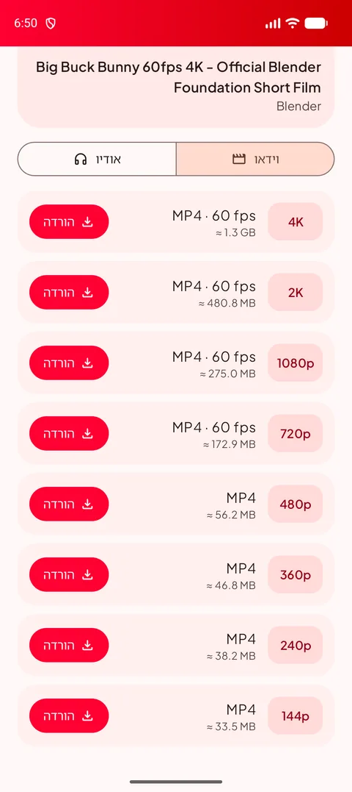
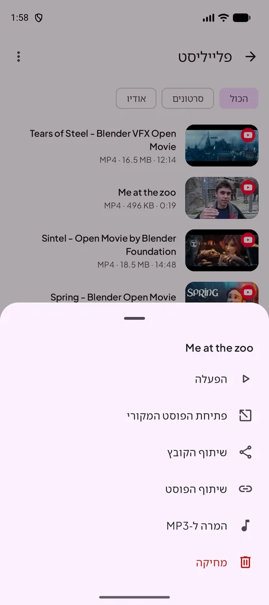
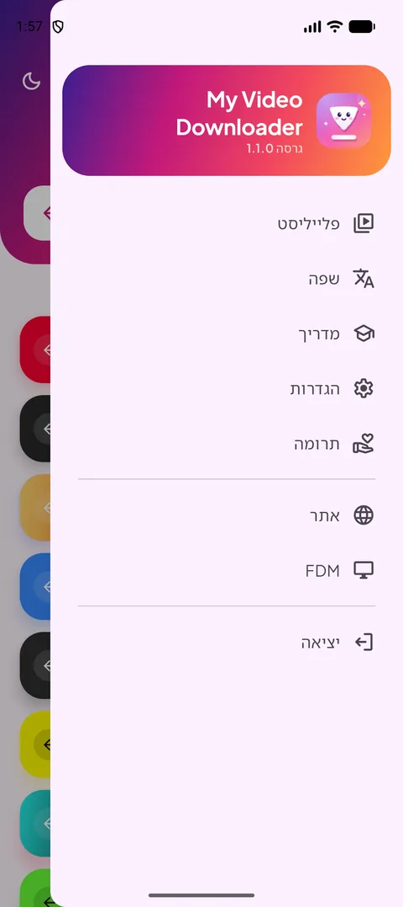
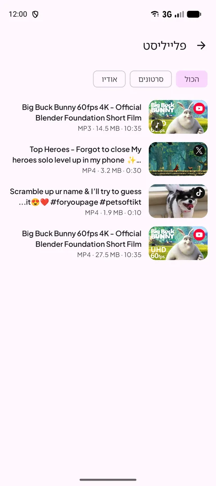
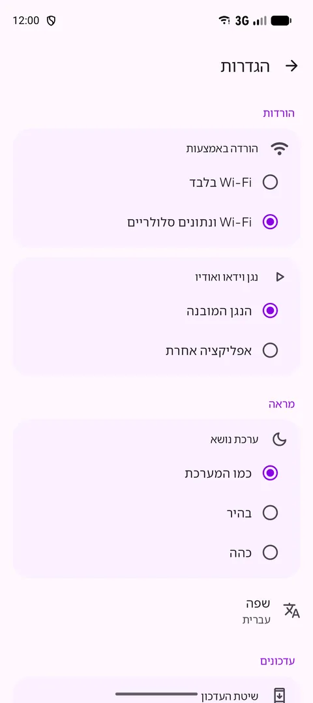
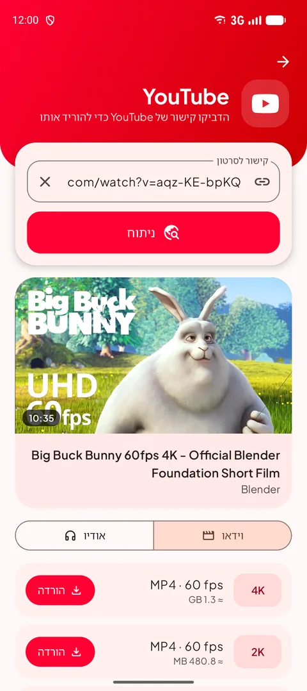
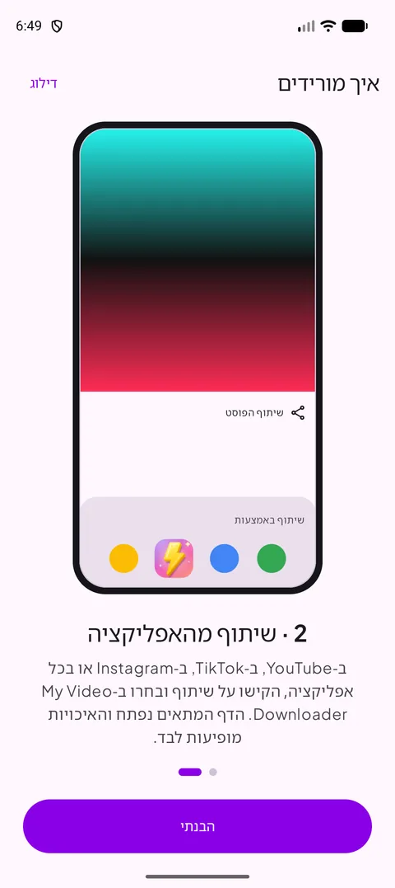
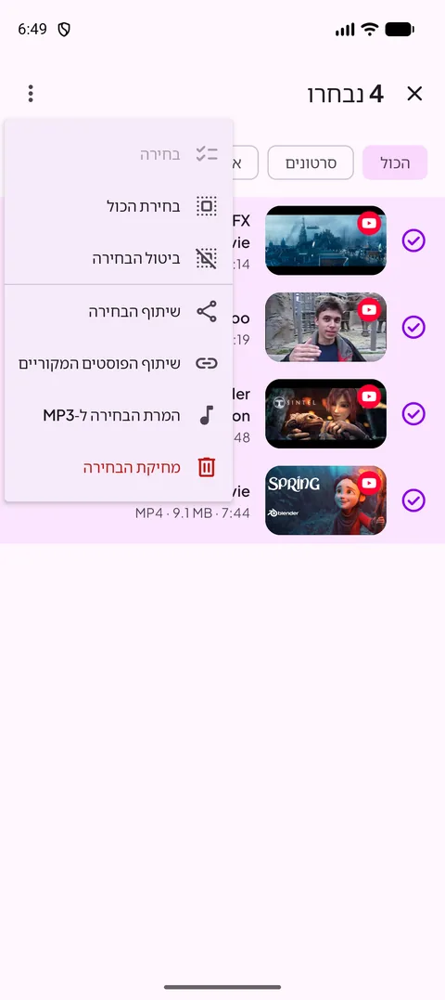
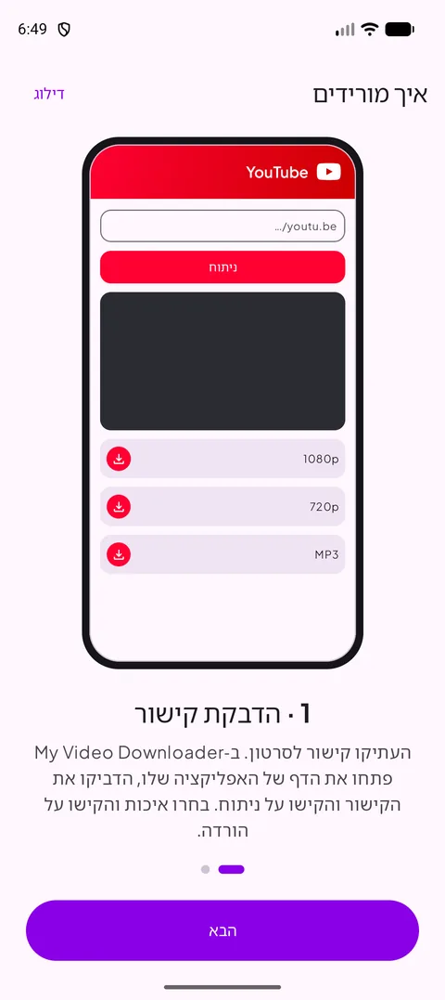

[English](README.md) · [Français](README.fr.md) · [العربية](README.ar.md) · [中文](README.zh.md) · [日本語](README.ja.md) · **עברית** · [हिन्दी](README.hi.md) · [한국어](README.ko.md) · [Italiano](README.it.md) · [Português](README.pt.md) · [Español](README.es.md) · [Deutsch](README.de.md) · [Русский](README.ru.md)

### הורידו סרטונים, שורטס וסטוריז מהאפליקציות האהובות עליכם — עד 4K או כ-MP3.

   

Android 12 ומעלה · חינם · ללא חשבון

## 📸 צילומי מסך

<table align="center"><tr>
<td align="center" valign="top"> <b>בחירת מקור</b></td><td align="center" valign="top"> <b>בחירת איכות</b></td><td align="center" valign="top"> <b>פעולות בלחיצה ארוכה</b></td>
</tr><tr>
<td align="center" valign="top"> <b>תפריט</b></td><td align="center" valign="top"> <b>הפלייליסט</b></td><td align="center" valign="top"> <b>הגדרות</b></td>
</tr></table>

## ✨ תכונות

- **חדש ב-1.1** — ניתוח מהיר בהרבה (יוטיוב), בחירה מרובה בפלייליסט, התקדמות MP3 באחוזים, מסך דולק בנגן עם כפתור לאורך/לרוחב, התראת Wi-Fi בלבד ורוסית.
- **כל הפלטפורמות הגדולות** — YouTube, ‏X, ‏Instagram, ‏Facebook, ‏Threads, ‏Snapchat, ‏TikTok, ‏Kick ורוב האתרים האחרים.
- **עד 4K** — כל האיכויות הזמינות, עם גודל הקובץ לפני ההורדה.
- **אודיו בלבד** — MP3 מ-128 עד 320 קילוביט לשנייה, או M4A מקורי.
- **שתפו כדי להוריד** — שתפו קישור מכל אפליקציה: הדף המתאים נפתח והאיכויות מוכנות.
- **פלייליסט** — הפעלה, שיתוף, המרה ל-MP3 או מחיקה, בסנכרון עם תיקיית Download.
- **מצב בהיר וכהה**, **13 שפות**, הורדה ב-Wi-Fi בלבד ונגן מובנה.
- **תמיד עובדת** — מנוע ההורדה מתעדכן לבד כשהאתרים משתנים.

## 🌐 אתרים נתמכים

       

<i>…ורוב האתרים שמציגים סרטון.</i>

## 📖 איך מורידים

### שיטה 1 — הדבקת קישור

1. העתיקו את הקישור לסרטון באפליקציה שלו (**שיתוף ← העתקת קישור**).
2. ב-My Video Downloader הקישו על כפתור הפלטפורמה, הדביקו את הקישור והקישו על **ניתוח**.
3. בחרו איכות וידאו או את הלשונית **אודיו**, ואז הקישו על **הורדה**.
4. הקובץ נשמר ב-**Download/My Video Downloader** ומופיע ב**פלייליסט**.

<table align="center"><tr>
<td align="center" valign="top"> <b>בחירת מקור</b></td><td align="center" valign="top"> <b>הדבקה וניתוח</b></td><td align="center" valign="top"> <b>בחירת איכות</b></td><td align="center" valign="top"> <b>הפלייליסט</b></td>
</tr></table>

### שיטה 2 — שיתוף מהאפליקציה

1. ב-YouTube, ‏TikTok, ‏Instagram, בדפדפן… הקישו על **שיתוף** ובחרו ב-**My Video Downloader**.
2. הדף המתאים נפתח והקישור מנותח אוטומטית.
3. בחרו איכות והקישו על **הורדה**.

<table align="center"><tr>
<td align="center" valign="top"> <b>שיתוף → My Video Downloader</b></td><td align="center" valign="top"> <b>בחירת איכות</b></td><td align="center" valign="top"> <b>מדריך מובנה</b></td>
</tr></table>

> 💡 טיפ: השדה בראש מסך הבית מקבל כל קישור ופותח לבד את הדף המתאים.

## 📲 התקנה

1. הורידו את ה-APK מדף ה-**[Releases](https://github.com/Oussama4422/Myvideodownloader/releases/latest)**.
2. פתחו את הקובץ ואשרו התקנה ממקור זה אם Android מבקש.
3. זהו — העדכונים מוצעים בתוך האפליקציה.

| קובץ | מתאים ל |
|---|---|
| [`MyVideoDownloader-vX.Y.Z-arm64-v8a.apk`](https://github.com/Oussama4422/Myvideodownloader/releases/latest) ⭐ | רוב הטלפונים (מומלץ) |
| [`MyVideoDownloader-vX.Y.Z-armeabi-v7a.apk`](https://github.com/Oussama4422/Myvideodownloader/releases/latest) | טלפונים ישנים של 32 ביט |
| [`MyVideoDownloader-vX.Y.Z-x86_64.apk`](https://github.com/Oussama4422/Myvideodownloader/releases/latest) | אמולטורים, Chromebook |
| [`MyVideoDownloader-vX.Y.Z-universal.apk`](https://github.com/Oussama4422/Myvideodownloader/releases/latest) | כל המכשירים (קובץ גדול יותר) |

## 🎨 עוד

<table align="center"><tr>
<td align="center" valign="top"> <b>תפריט בחירה</b></td><td align="center" valign="top"> <b>המרה ל-MP3</b></td><td align="center" valign="top"> <b>נגן מובנה</b></td><td align="center" valign="top"> <b>התראת Wi-Fi בלבד</b></td>
</tr><tr>
<td align="center" valign="top"> <b>מצב כהה</b></td><td align="center" valign="top"> <b>המרה ל-MP3</b></td><td align="center" valign="top"> <b>מדריך מובנה</b></td><td align="center" valign="top"> <b>תמיכה בפרויקט</b></td>
</tr></table>

## 🌍 זמינה ב-13 שפות

האפליקציה עוברת אוטומטית לשפת הטלפון (אנגלית כברירת מחדל), ואפשר גם לשנות אותה מהתפריט.

<table align="center"><tr>
<td align="center"> English</td>
<td align="center"> Français</td>
<td align="center"> العربية</td>
<td align="center"> 中文</td>
<td align="center"> 日本語</td>
<td align="center"> עברית</td>
<td align="center"> हिन्दी</td>
</tr><tr>
<td align="center"> 한국어</td>
<td align="center"> Italiano</td>
<td align="center"> Português</td>
<td align="center"> Español</td>
<td align="center"> Deutsch</td>
<td align="center"> Русский</td>
</tr></table>

## ❓ שאלות נפוצות

<b>האם היא חינמית?</b>

כן. ללא חשבון וללא מינוי.

<b>איזה APK לבחור?</b>

**arm64-v8a** עובד כמעט בכל טלפון עם Android 12 ומעלה. אם הוא לא מותקן, בחרו **universal**.

<b>למה היא לא ב-Google Play?</b>

Google Play לא מאפשר אפליקציות שמורידות סרטוני YouTube, ולכן האפליקציה מופצת כאן וב-videodownloader.my.

<b>אפשר להוריד סרטונים או סטוריז פרטיים?</b>

רק תוכן ציבורי. אי אפשר להוריד פוסטים פרטיים וסטוריז שדורשים חשבון.

<b>איפה הקבצים שלי?</b>

בתיקייה **Download/My Video Downloader** בטלפון, וב**פלייליסט** של האפליקציה.

## 💜 תמיכה בפרויקט

My Video Downloader חינמית. אם היא עוזרת לכם, אפשר לתמוך בפיתוח שלה:

 PayPal — שלחו לכתובת המייל הזו: <code>elsouad212@gmail.com</code>

 <b>Bitcoin (BTC)</b> <code>bc1qv7h60rf3yrcq2lgdqd9m74ezltchzxvw7lfcgd</code>

## 🔗 קישורים

- 🌐 אתר — https://videodownloader.my
- 🖥️ File Download Manager ל-Windows — https://filedownloadmanager.com/

---

הורידו רק תוכן שיש לכם זכות לשמור. שמות הפלטפורמות והלוגואים שלהן שייכים לבעליהם.

