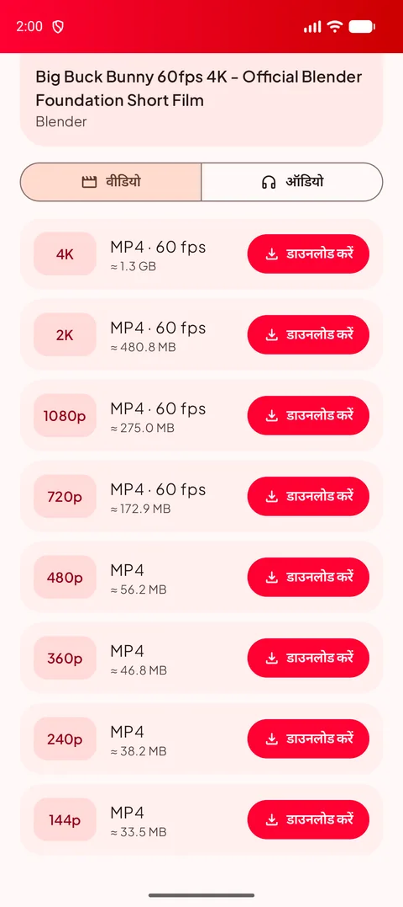
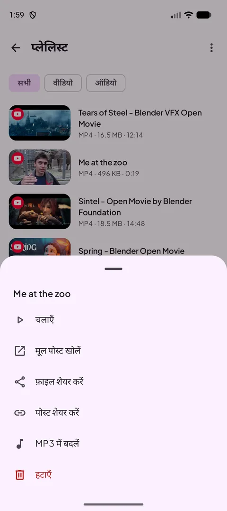
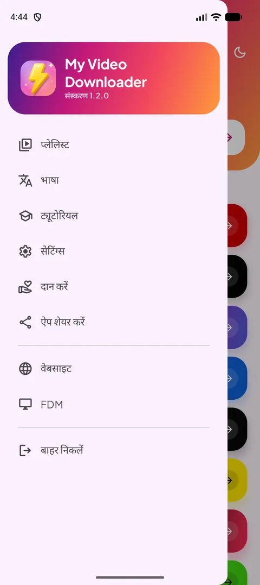
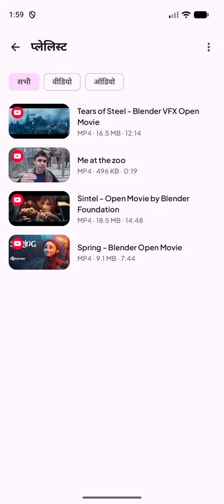
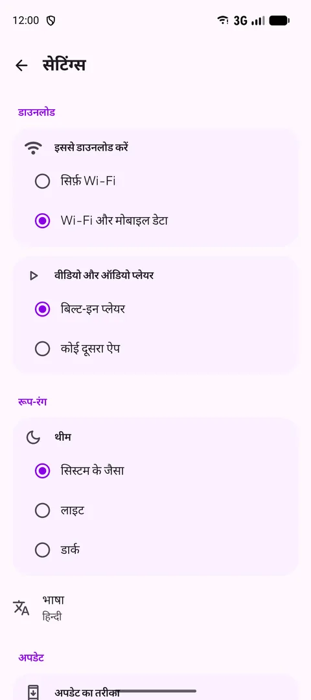
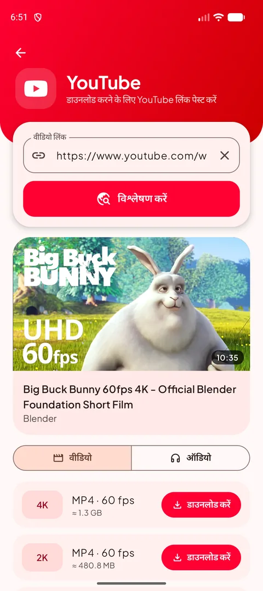
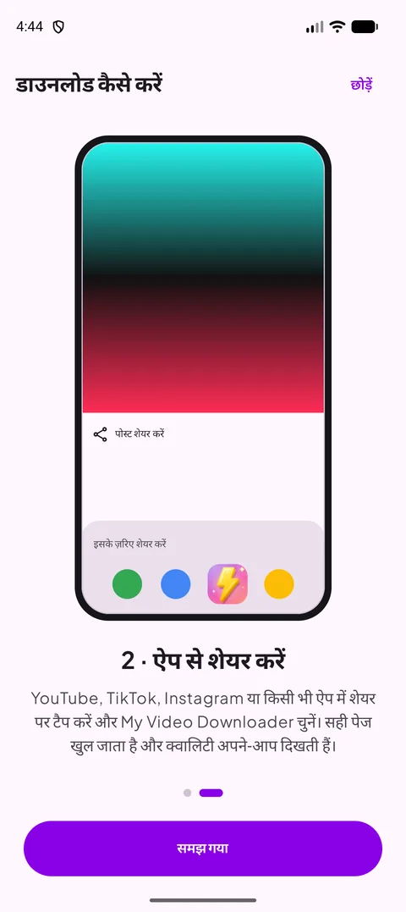
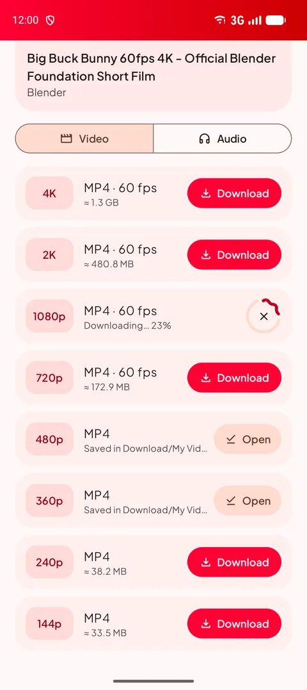
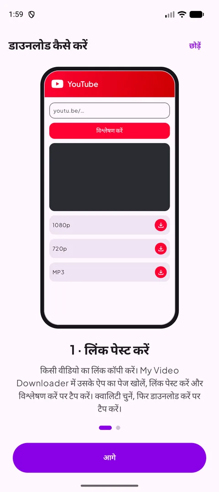

[English](README.md) · [Français](README.fr.md) · [العربية](README.ar.md) · [中文](README.zh.md) · [日本語](README.ja.md) · [עברית](README.he.md) · **हिन्दी** · [한국어](README.ko.md) · [Italiano](README.it.md) · [Português](README.pt.md) · [Español](README.es.md) · [Deutsch](README.de.md)

### अपने पसंदीदा ऐप्स से वीडियो, शॉर्ट्स और स्टोरीज़ डाउनलोड करें — 4K तक, या MP3 में।

   

Android 14 या नया · मुफ़्त · कोई खाता नहीं

## 📸 स्क्रीनशॉट

<table align="center"><tr>
<td align="center" valign="top"> <b>स्रोत चुनें</b></td><td align="center" valign="top"> <b>क्वालिटी चुनें</b></td><td align="center" valign="top"> <b>लंबे दबाव वाले विकल्प</b></td>
</tr><tr>
<td align="center" valign="top"> <b>मेन्यू</b></td><td align="center" valign="top"> <b>आपकी प्लेलिस्ट</b></td><td align="center" valign="top"> <b>सेटिंग्स</b></td>
</tr></table>

## ✨ सुविधाएँ

- **सभी बड़े प्लेटफ़ॉर्म** — YouTube, X, Instagram, Facebook, Threads, Snapchat, TikTok, Kick और ज़्यादातर दूसरी वेबसाइटें।
- **4K तक** — हर उपलब्ध क्वालिटी, डाउनलोड से पहले फ़ाइल का आकार दिखता है।
- **सिर्फ़ ऑडियो** — 128 से 320 kbps तक MP3, या मूल M4A।
- **शेयर करके डाउनलोड** — किसी भी ऐप से लिंक शेयर करें: सही पेज क्वालिटी के साथ खुल जाता है।
- **प्लेलिस्ट** — चलाएँ, शेयर करें, MP3 में बदलें या हटाएँ; यह आपके Download फ़ोल्डर के साथ सिंक रहती है।
- **लाइट और डार्क मोड**, **12 भाषाएँ**, सिर्फ़ Wi-Fi पर डाउनलोड और बिल्ट-इन प्लेयर।
- **हमेशा काम करता है** — वेबसाइटें बदलने पर डाउनलोड इंजन खुद अपडेट हो जाता है।

## 🌐 समर्थित साइटें

       

<i>…और वीडियो दिखाने वाली ज़्यादातर वेबसाइटें।</i>

## 📖 डाउनलोड कैसे करें

### तरीका 1 — लिंक पेस्ट करें

1. वीडियो के ऐप में उसका लिंक कॉपी करें (**शेयर → लिंक कॉपी करें**)।
2. My Video Downloader में प्लेटफ़ॉर्म का बटन टैप करें, लिंक पेस्ट करें और **विश्लेषण करें** टैप करें।
3. वीडियो क्वालिटी या **ऑडियो** टैब चुनें, फिर **डाउनलोड करें** टैप करें।
4. फ़ाइल **Download/My Video Downloader** में सेव होती है और **प्लेलिस्ट** में दिखती है।

<table align="center"><tr>
<td align="center" valign="top"> <b>स्रोत चुनें</b></td><td align="center" valign="top"> <b>पेस्ट करें और विश्लेषण करें</b></td><td align="center" valign="top"> <b>क्वालिटी चुनें</b></td><td align="center" valign="top"> <b>आपकी प्लेलिस्ट</b></td>
</tr></table>

### तरीका 2 — ऐप से शेयर करें

1. YouTube, TikTok, Instagram या ब्राउज़र में **शेयर** टैप करें और **My Video Downloader** चुनें।
2. सही पेज खुलता है और लिंक का विश्लेषण अपने-आप होता है।
3. क्वालिटी चुनें और **डाउनलोड करें** टैप करें।

<table align="center"><tr>
<td align="center" valign="top"> <b>शेयर → My Video Downloader</b></td><td align="center" valign="top"> <b>क्वालिटी चुनें</b></td><td align="center" valign="top"> <b>बिल्ट-इन ट्यूटोरियल</b></td>
</tr></table>

> 💡 टिप: होम स्क्रीन के ऊपर वाला फ़ील्ड कोई भी लिंक लेता है और सही पेज खुद खोल देता है।

## 📲 इंस्टॉलेशन

1. **[Releases](https://github.com/Oussama4422/Myvideodownloader/releases/latest)** पेज से APK डाउनलोड करें।
2. फ़ाइल खोलें और अगर Android पूछे तो इस स्रोत से इंस्टॉल करने की अनुमति दें।
3. बस — अपडेट ऐप के अंदर ही मिलते हैं।

| फ़ाइल | किसके लिए |
|---|---|
| [`MyVideoDownloader-vX.Y.Z-arm64-v8a.apk`](https://github.com/Oussama4422/Myvideodownloader/releases/latest) ⭐ | ज़्यादातर फ़ोन (सुझाया गया) |
| [`MyVideoDownloader-vX.Y.Z-armeabi-v7a.apk`](https://github.com/Oussama4422/Myvideodownloader/releases/latest) | पुराने 32-बिट फ़ोन |
| [`MyVideoDownloader-vX.Y.Z-x86_64.apk`](https://github.com/Oussama4422/Myvideodownloader/releases/latest) | एम्युलेटर, Chromebook |
| [`MyVideoDownloader-vX.Y.Z-universal.apk`](https://github.com/Oussama4422/Myvideodownloader/releases/latest) | कोई भी डिवाइस (बड़ी फ़ाइल) |

## 🎨 और

<table align="center"><tr>
<td align="center" valign="top"> <b>डार्क मोड</b></td><td align="center" valign="top"> <b>डाउनलोड हो रहा है</b></td><td align="center" valign="top"> <b>MP3 में बदलें</b></td><td align="center" valign="top"> <b>बिल्ट-इन ट्यूटोरियल</b></td>
</tr></table>

## 🌍 12 भाषाओं में उपलब्ध

ऐप अपने-आप आपके फ़ोन की भाषा अपनाता है (डिफ़ॉल्ट अंग्रेज़ी)। आप इसे मेन्यू से भी बदल सकते हैं।

<table align="center"><tr>
<td align="center"> English</td>
<td align="center"> Français</td>
<td align="center"> العربية</td>
<td align="center"> 中文</td>
<td align="center"> 日本語</td>
<td align="center"> עברית</td>
</tr><tr>
<td align="center"> हिन्दी</td>
<td align="center"> 한국어</td>
<td align="center"> Italiano</td>
<td align="center"> Português</td>
<td align="center"> Español</td>
<td align="center"> Deutsch</td>
</tr></table>

## ❓ अक्सर पूछे जाने वाले सवाल

<b>क्या यह मुफ़्त है?</b>

हाँ। न खाता, न सब्सक्रिप्शन।

<b>कौन-सा APK चुनूँ?</b>

**arm64-v8a** Android 14 या नए लगभग हर फ़ोन पर चलता है। अगर इंस्टॉल न हो, तो **universal** लें।

<b>यह Google Play पर क्यों नहीं है?</b>

Google Play, YouTube वीडियो डाउनलोड करने वाले ऐप की अनुमति नहीं देता, इसलिए ऐप यहाँ और videodownloader.my पर मिलता है।

<b>क्या निजी वीडियो या स्टोरीज़ डाउनलोड हो सकती हैं?</b>

सिर्फ़ सार्वजनिक सामग्री। खाते की ज़रूरत वाली निजी पोस्ट और स्टोरीज़ डाउनलोड नहीं हो सकतीं।

<b>मेरी फ़ाइलें कहाँ हैं?</b>

आपके फ़ोन के **Download/My Video Downloader** फ़ोल्डर में, और ऐप की **प्लेलिस्ट** में।

## 💜 प्रोजेक्ट को सपोर्ट करें

My Video Downloader मुफ़्त है। अगर यह आपके काम आता है, तो आप इसके विकास में मदद कर सकते हैं:

 <b>Bitcoin (BTC)</b> <code>bc1qv7h60rf3yrcq2lgdqd9m74ezltchzxvw7lfcgd</code>

## 🔗 लिंक

- 🌐 वेबसाइट — https://videodownloader.my
- 🖥️ Windows के लिए File Download Manager — https://filedownloadmanager.com/

---

सिर्फ़ वही सामग्री डाउनलोड करें जिसे सेव करने का आपको अधिकार है। प्लेटफ़ॉर्म के नाम और लोगो उनके मालिकों के हैं।
