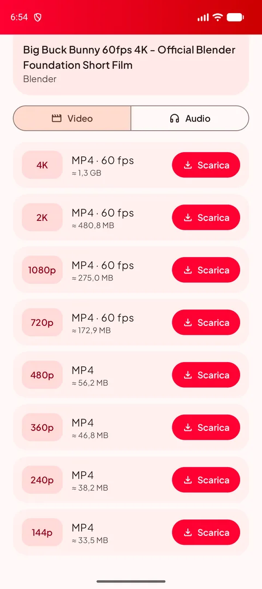
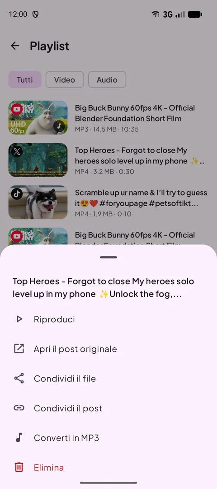
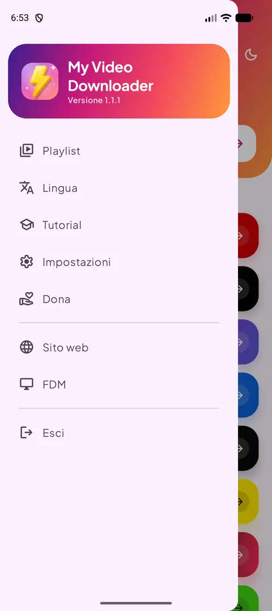
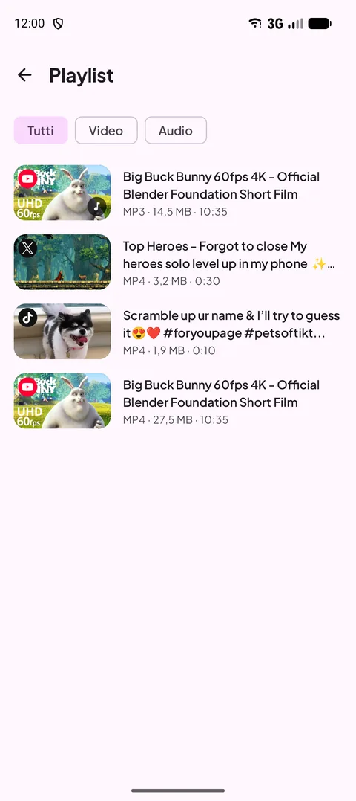
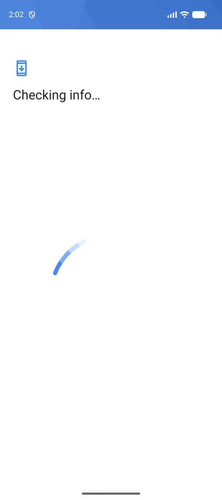
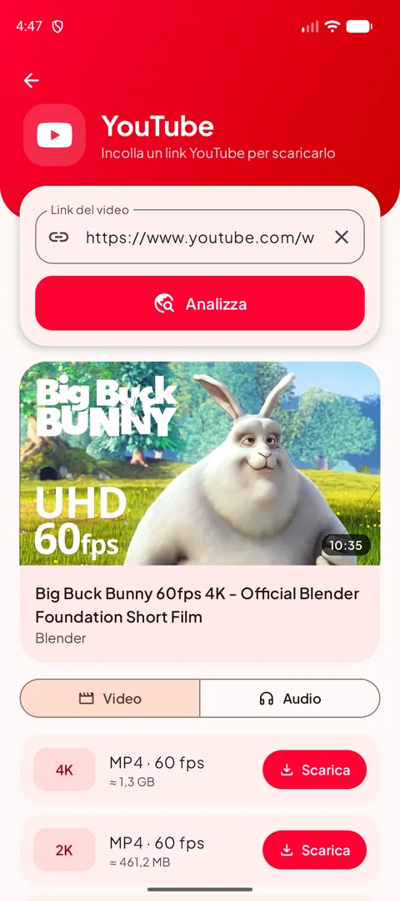
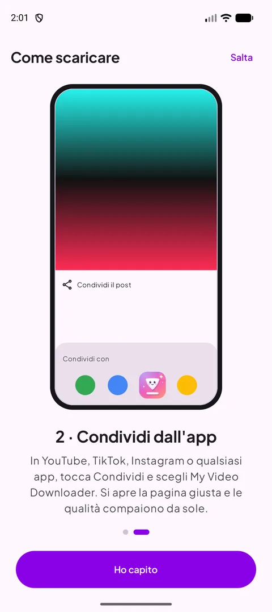
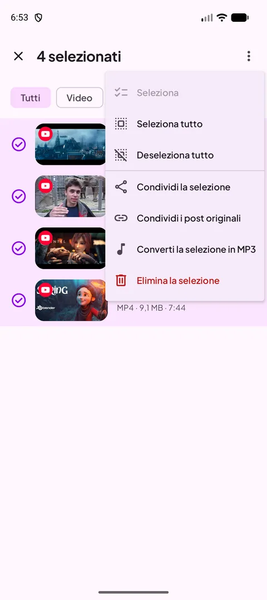
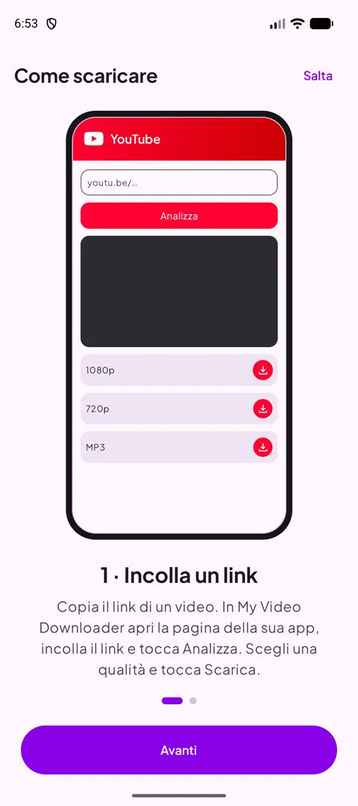

[English](README.md) · [Français](README.fr.md) · [العربية](README.ar.md) · [中文](README.zh.md) · [日本語](README.ja.md) · [עברית](README.he.md) · [हिन्दी](README.hi.md) · [한국어](README.ko.md) · **Italiano** · [Português](README.pt.md) · [Español](README.es.md) · [Deutsch](README.de.md) · [Русский](README.ru.md)

### Scarica video, short e storie dalle tue app preferite — fino al 4K, o in MP3.

   

Android 12 o successivo · gratis · senza account

## 📸 Screenshot

<table align="center"><tr>
<td align="center" valign="top"> <b>Scegli una fonte</b></td><td align="center" valign="top"> <b>Scegli la qualità</b></td><td align="center" valign="top"> <b>Azioni con pressione prolungata</b></td>
</tr><tr>
<td align="center" valign="top"> <b>Menu</b></td><td align="center" valign="top"> <b>La tua playlist</b></td><td align="center" valign="top"> <b>Impostazioni</b></td>
</tr></table>

## ✨ Funzionalità

- **Novità della 1.2** — analisi dei link circa due volte più veloce su tutti i siti, titolo e immagine del video subito visibili, ricerca nella playlist e pulsante «Condividi l'app» nel menu.
- **Novità della 1.1** — analisi molto più veloce (YouTube), selezione multipla nella playlist, avanzamento MP3 in %, schermo acceso nel lettore con pulsante verticale/orizzontale, avviso Solo Wi-Fi e russo.
- **Tutte le grandi piattaforme** — YouTube, X, Instagram, Facebook, Threads, Snapchat, TikTok, Kick e la maggior parte degli altri siti.
- **Fino al 4K** — tutte le qualità disponibili, con la dimensione del file prima di scaricare.
- **Solo audio** — MP3 da 128 a 320 kbps, o l'M4A originale.
- **Condividi per scaricare** — condividi un link da qualsiasi app: si apre la pagina giusta con le qualità pronte.
- **Playlist** — riproduci, condividi, converti in MP3 o elimina; resta sincronizzata con la cartella Download.
- **Modalità chiara e scura**, **13 lingue**, download solo in Wi-Fi e lettore integrato.
- **Sempre funzionante** — il motore di download si aggiorna da solo quando i siti cambiano.

## 🌐 Siti supportati

       

<i>…e la maggior parte dei siti che mostrano un video.</i>

## 📖 Come scaricare

### Metodo 1 — Incolla un link

1. Copia il link del video nella sua app (**Condividi → Copia link**).
2. In My Video Downloader tocca il pulsante della piattaforma, incolla il link e tocca **Analizza**.
3. Scegli una qualità video o la scheda **Audio**, poi tocca **Scarica**.
4. Il file viene salvato in **Download/My Video Downloader** e compare nella **Playlist**.

<table align="center"><tr>
<td align="center" valign="top"> <b>Scegli una fonte</b></td><td align="center" valign="top"> <b>Incolla e analizza</b></td><td align="center" valign="top"> <b>Scegli la qualità</b></td><td align="center" valign="top"> <b>La tua playlist</b></td>
</tr></table>

### Metodo 2 — Condividi dall'app

1. In YouTube, TikTok, Instagram, nel browser… tocca **Condividi** e scegli **My Video Downloader**.
2. Si apre la pagina giusta e il link viene analizzato automaticamente.
3. Scegli una qualità e tocca **Scarica**.

<table align="center"><tr>
<td align="center" valign="top"> <b>Condividi → My Video Downloader</b></td><td align="center" valign="top"> <b>Scegli la qualità</b></td><td align="center" valign="top"> <b>Tutorial integrato</b></td>
</tr></table>

> 💡 Suggerimento: il campo in cima alla schermata iniziale accetta qualsiasi link e apre da solo la pagina giusta.

## 📲 Installazione

1. Scarica l'APK dalla pagina **[Releases](https://github.com/Oussama4422/Myvideodownloader/releases/latest)**.
2. Apri il file e consenti l'installazione da questa fonte se Android lo chiede.
3. Fatto — gli aggiornamenti vengono proposti nell'app.

| File | Per |
|---|---|
| [`MyVideoDownloader-vX.Y.Z-arm64-v8a.apk`](https://github.com/Oussama4422/Myvideodownloader/releases/latest) ⭐ | La maggior parte dei telefoni (consigliato) |
| [`MyVideoDownloader-vX.Y.Z-armeabi-v7a.apk`](https://github.com/Oussama4422/Myvideodownloader/releases/latest) | Telefoni a 32 bit più vecchi |
| [`MyVideoDownloader-vX.Y.Z-x86_64.apk`](https://github.com/Oussama4422/Myvideodownloader/releases/latest) | Emulatori, Chromebook |
| [`MyVideoDownloader-vX.Y.Z-universal.apk`](https://github.com/Oussama4422/Myvideodownloader/releases/latest) | Qualsiasi dispositivo (file più grande) |

## 🎨 Altro

<table align="center"><tr>
<td align="center" valign="top"> <b>Menu di selezione</b></td><td align="center" valign="top"> <b>Converti in MP3</b></td><td align="center" valign="top"> <b>Lettore integrato</b></td><td align="center" valign="top"> <b>Avviso Solo Wi-Fi</b></td>
</tr><tr>
<td align="center" valign="top"> <b>Modalità scura</b></td><td align="center" valign="top"> <b>Converti in MP3</b></td><td align="center" valign="top"> <b>Tutorial integrato</b></td><td align="center" valign="top"> <b>Sostieni il progetto</b></td>
</tr></table>

## 🌍 Disponibile in 13 lingue

L'app segue automaticamente la lingua del telefono (inglese come predefinito). Puoi anche cambiarla dal menu.

<table align="center"><tr>
<td align="center"> English</td>
<td align="center"> Français</td>
<td align="center"> العربية</td>
<td align="center"> 中文</td>
<td align="center"> 日本語</td>
<td align="center"> עברית</td>
<td align="center"> हिन्दी</td>
</tr><tr>
<td align="center"> 한국어</td>
<td align="center"> Italiano</td>
<td align="center"> Português</td>
<td align="center"> Español</td>
<td align="center"> Deutsch</td>
<td align="center"> Русский</td>
</tr></table>

## ❓ Domande frequenti

<b>È gratuita?</b>

Sì. Nessun account, nessun abbonamento.

<b>Quale APK scelgo?</b>

**arm64-v8a** funziona su quasi tutti i telefoni con Android 12 o successivo. Se non si installa, prendi **universal**.

<b>Perché non è su Google Play?</b>

Google Play non consente app che scaricano video di YouTube, quindi l'app è distribuita qui e su videodownloader.my.

<b>Posso scaricare video o storie private?</b>

Solo contenuti pubblici. I post privati e le storie che richiedono un account non si possono scaricare.

<b>Dove sono i miei file?</b>

Nella cartella **Download/My Video Downloader** del telefono e nella **Playlist** dell'app.

## 💜 Sostieni il progetto

My Video Downloader è gratuita. Se ti è utile, puoi sostenerne lo sviluppo:

 PayPal — invia a questo indirizzo email: <code>elsouad212@gmail.com</code>

 <b>Bitcoin (BTC)</b> <code>bc1qv7h60rf3yrcq2lgdqd9m74ezltchzxvw7lfcgd</code>

## 🔗 Link

- 🌐 Sito web — https://videodownloader.my
- 🖥️ File Download Manager per Windows — https://filedownloadmanager.com/

---

Scarica solo contenuti che hai il diritto di salvare. I nomi e i loghi delle piattaforme appartengono ai rispettivi proprietari.
