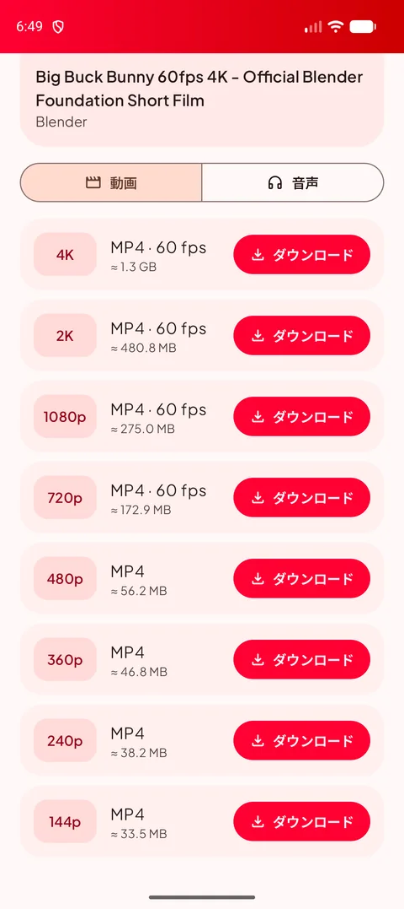
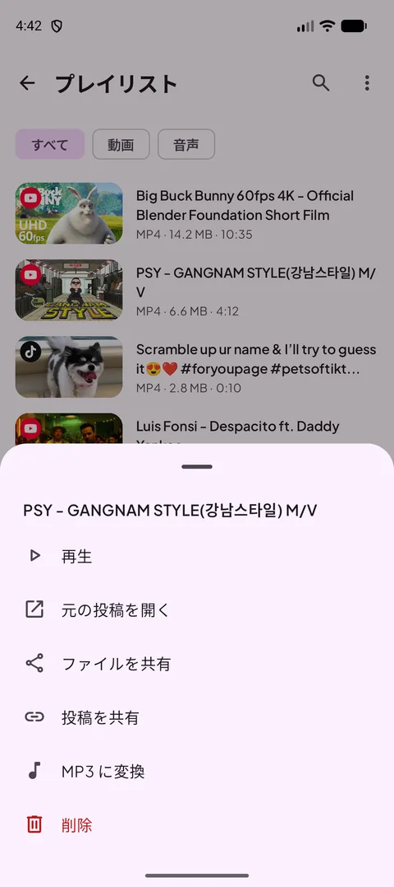
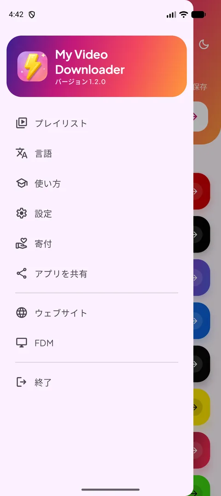
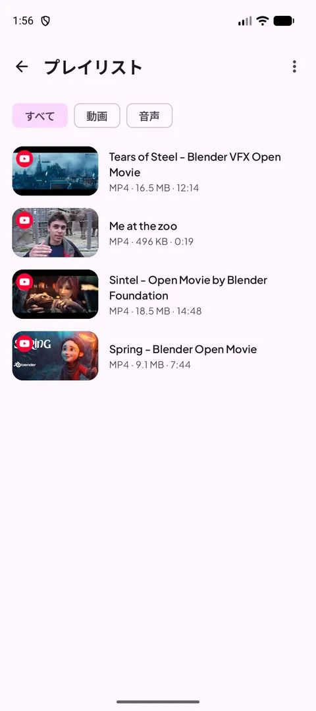
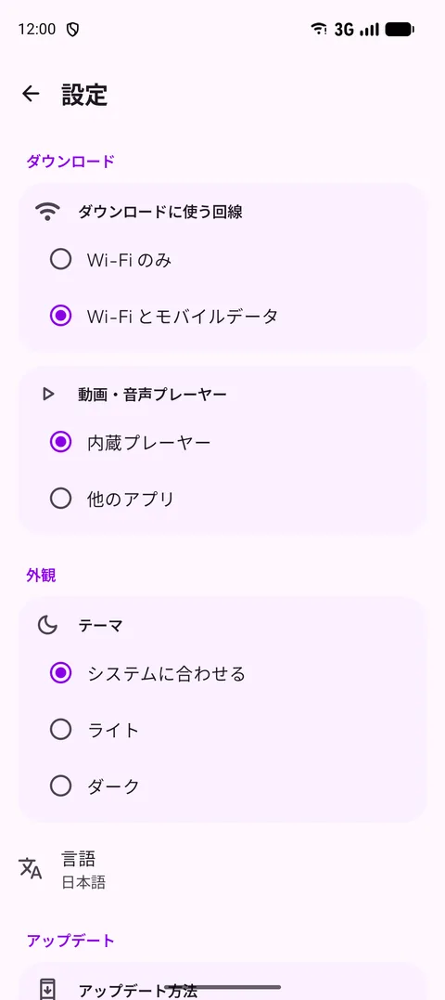
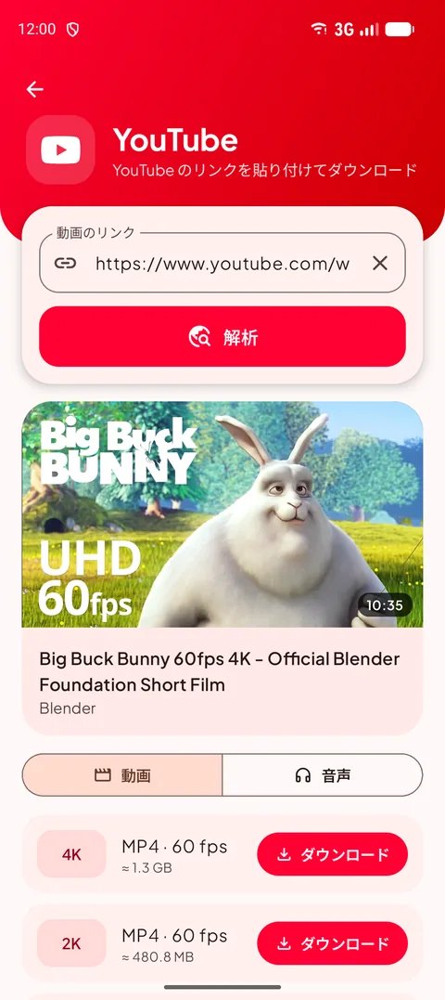
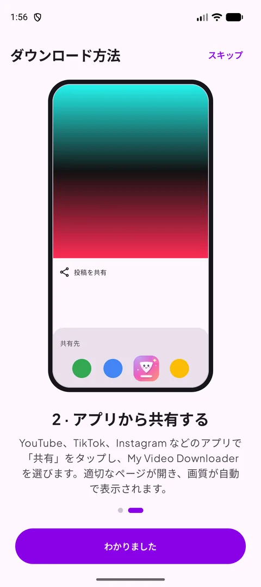
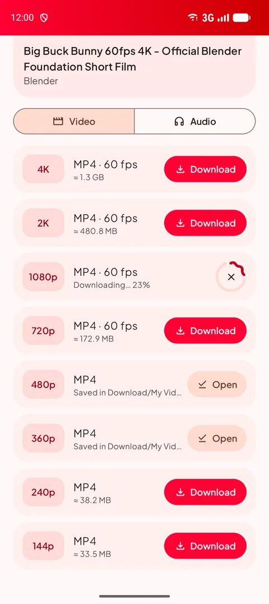
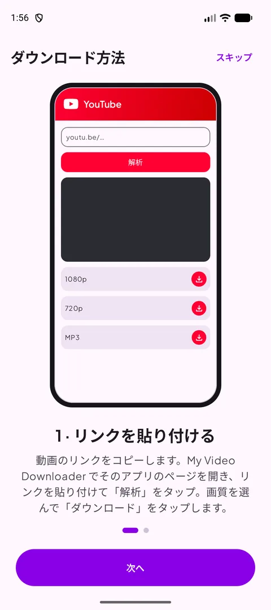

[English](README.md) · [Français](README.fr.md) · [العربية](README.ar.md) · [中文](README.zh.md) · **日本語** · [עברית](README.he.md) · [हिन्दी](README.hi.md) · [한국어](README.ko.md) · [Italiano](README.it.md) · [Português](README.pt.md) · [Español](README.es.md) · [Deutsch](README.de.md)

### お気に入りのアプリの動画・ショート・ストーリーを保存 — 最大 4K、または MP3 で。

   

Android 14 以降 · 無料 · アカウント不要

## 📸 スクリーンショット

<table align="center"><tr>
<td align="center" valign="top"> <b>ソースを選ぶ</b></td><td align="center" valign="top"> <b>画質を選ぶ</b></td><td align="center" valign="top"> <b>長押しメニュー</b></td>
</tr><tr>
<td align="center" valign="top"> <b>メニュー</b></td><td align="center" valign="top"> <b>プレイリスト</b></td><td align="center" valign="top"> <b>設定</b></td>
</tr></table>

## ✨ 機能

- **主要プラットフォームに対応** — YouTube、X、Instagram、Facebook、Threads、Snapchat、TikTok、Kick、その他ほとんどのサイト。
- **最大 4K** — 利用できるすべての画質を、ダウンロード前のファイルサイズ付きで表示。
- **音声のみ** — 128〜320 kbps の MP3、または元の M4A。
- **共有してダウンロード** — どのアプリからでもリンクを共有すると、適切なページが開き画質が表示されます。
- **プレイリスト** — 再生・共有・MP3 変換・削除。Download フォルダと常に同期します。
- **ライト／ダークモード**、**12 言語**、Wi-Fi のみのダウンロード、内蔵プレーヤー。
- **いつでも使える** — サイトの変更に合わせてダウンロードエンジンが自動で更新されます。

## 🌐 対応サイト

       

<i>…そして動画を表示するほとんどのサイト。</i>

## 📖 ダウンロード方法

### 方法 1 — リンクを貼り付ける

1. 動画のアプリでリンクをコピーします（**共有 → リンクをコピー**）。
2. My Video Downloader でプラットフォームのボタンをタップし、リンクを貼り付けて **解析** をタップします。
3. 動画の画質または **音声** タブを選び、**ダウンロード** をタップします。
4. ファイルは **Download/My Video Downloader** に保存され、**プレイリスト** に表示されます。

<table align="center"><tr>
<td align="center" valign="top"> <b>ソースを選ぶ</b></td><td align="center" valign="top"> <b>貼り付けて解析</b></td><td align="center" valign="top"> <b>画質を選ぶ</b></td><td align="center" valign="top"> <b>プレイリスト</b></td>
</tr></table>

### 方法 2 — アプリから共有する

1. YouTube、TikTok、Instagram、ブラウザなどで **共有** をタップし、**My Video Downloader** を選びます。
2. 適切なページが開き、リンクが自動で解析されます。
3. 画質を選んで **ダウンロード** をタップします。

<table align="center"><tr>
<td align="center" valign="top"> <b>共有 → My Video Downloader</b></td><td align="center" valign="top"> <b>画質を選ぶ</b></td><td align="center" valign="top"> <b>内蔵チュートリアル</b></td>
</tr></table>

> 💡 ヒント：ホーム画面上部の入力欄はどんなリンクにも対応し、適切なページを自動で開きます。

## 📲 インストール

1. **[Releases](https://github.com/Oussama4422/Myvideodownloader/releases/latest)** ページから APK をダウンロードします。
2. ファイルを開き、Android に求められたらこの提供元からのインストールを許可します。
3. 以上です — アップデートはアプリ内で案内されます。

| ファイル | 対象 |
|---|---|
| [`MyVideoDownloader-vX.Y.Z-arm64-v8a.apk`](https://github.com/Oussama4422/Myvideodownloader/releases/latest) ⭐ | ほとんどのスマートフォン（推奨） |
| [`MyVideoDownloader-vX.Y.Z-armeabi-v7a.apk`](https://github.com/Oussama4422/Myvideodownloader/releases/latest) | 古い 32 ビット端末 |
| [`MyVideoDownloader-vX.Y.Z-x86_64.apk`](https://github.com/Oussama4422/Myvideodownloader/releases/latest) | エミュレーター、Chromebook |
| [`MyVideoDownloader-vX.Y.Z-universal.apk`](https://github.com/Oussama4422/Myvideodownloader/releases/latest) | すべての端末（サイズ大） |

## 🎨 その他

<table align="center"><tr>
<td align="center" valign="top"> <b>ダークモード</b></td><td align="center" valign="top"> <b>ダウンロード中</b></td><td align="center" valign="top"> <b>MP3 に変換</b></td><td align="center" valign="top"> <b>内蔵チュートリアル</b></td>
</tr></table>

## 🌍 12 言語に対応

アプリはスマートフォンの言語に自動で合わせます（既定は英語）。メニューから変更することもできます。

<table align="center"><tr>
<td align="center"> English</td>
<td align="center"> Français</td>
<td align="center"> العربية</td>
<td align="center"> 中文</td>
<td align="center"> 日本語</td>
<td align="center"> עברית</td>
</tr><tr>
<td align="center"> हिन्दी</td>
<td align="center"> 한국어</td>
<td align="center"> Italiano</td>
<td align="center"> Português</td>
<td align="center"> Español</td>
<td align="center"> Deutsch</td>
</tr></table>

## ❓ よくある質問

<b>無料ですか？</b>

はい。アカウントもサブスクリプションも不要です。

<b>どの APK を選べばいいですか？</b>

**arm64-v8a** は Android 14 以降のほぼすべての端末で動作します。インストールできない場合は **universal** を選んでください。

<b>なぜ Google Play にないのですか？</b>

Google Play では YouTube 動画をダウンロードするアプリが許可されていないため、ここと videodownloader.my で配布しています。

<b>非公開の動画やストーリーもダウンロードできますか？</b>

公開コンテンツのみです。アカウントが必要な非公開投稿やストーリーはダウンロードできません。

<b>ファイルはどこにありますか？</b>

端末の **Download/My Video Downloader** フォルダと、アプリの **プレイリスト** にあります。

## 💜 プロジェクトを応援

My Video Downloader は無料です。役に立ったら、開発を応援していただけます：

 <b>Bitcoin (BTC)</b> <code>bc1qv7h60rf3yrcq2lgdqd9m74ezltchzxvw7lfcgd</code>

## 🔗 リンク

- 🌐 ウェブサイト — https://videodownloader.my
- 🖥️ Windows 用 File Download Manager — https://filedownloadmanager.com/

---

保存する権利のあるコンテンツのみをダウンロードしてください。各プラットフォームの名称とロゴは各所有者に帰属します。
