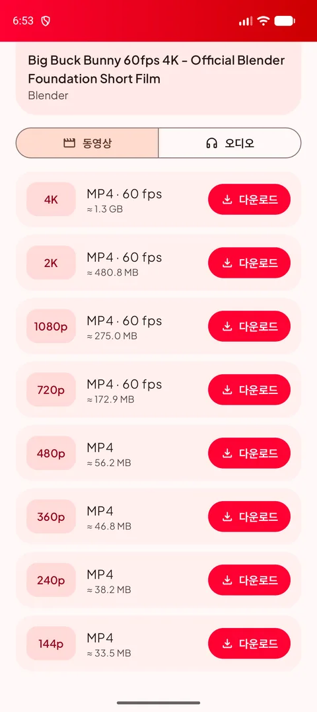
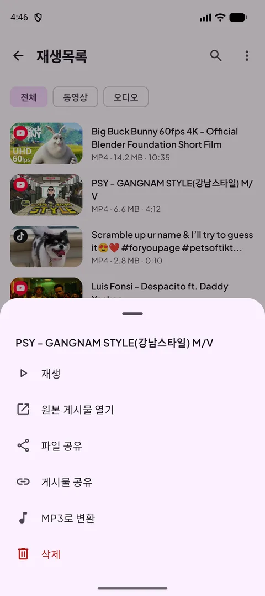
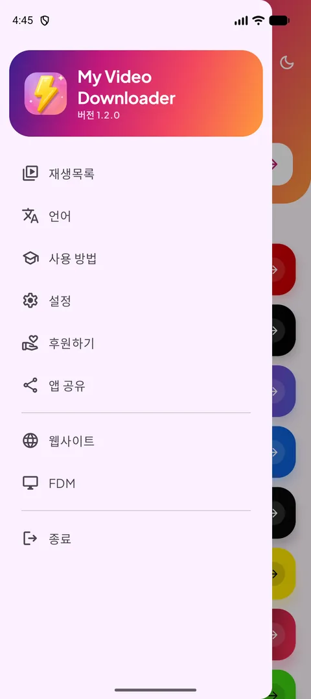
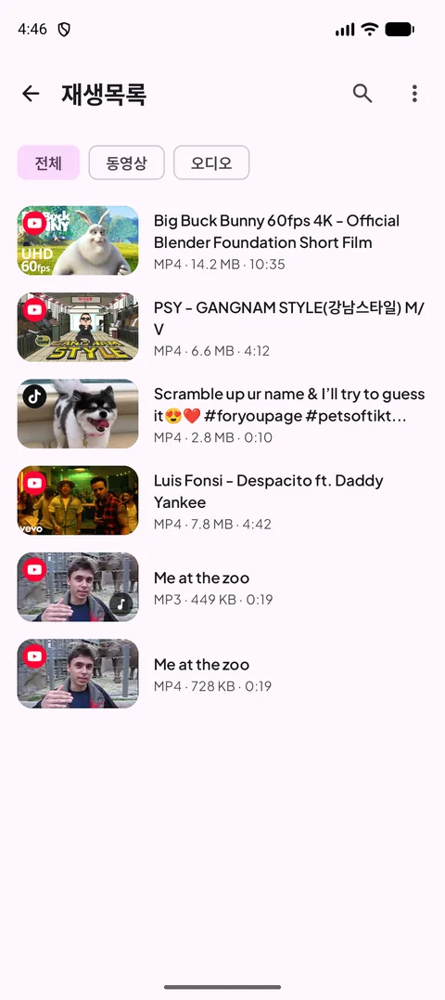
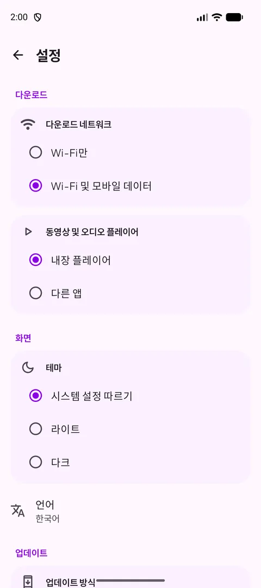
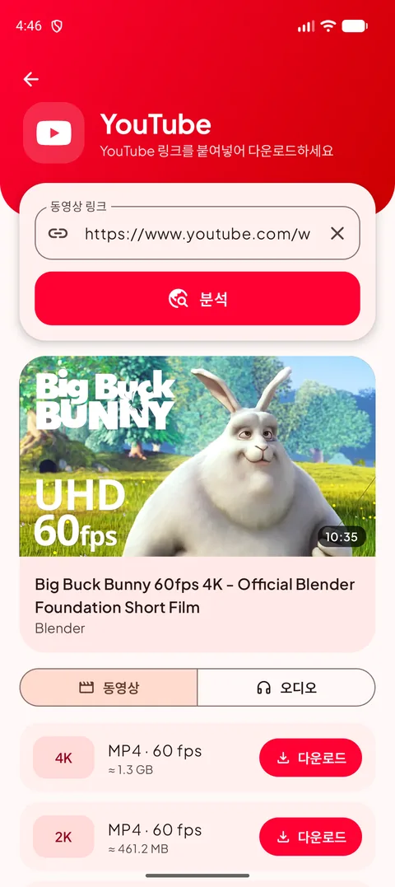
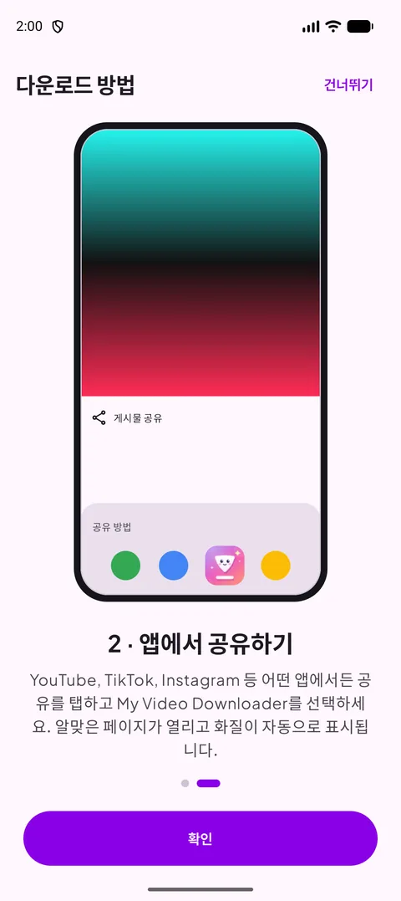
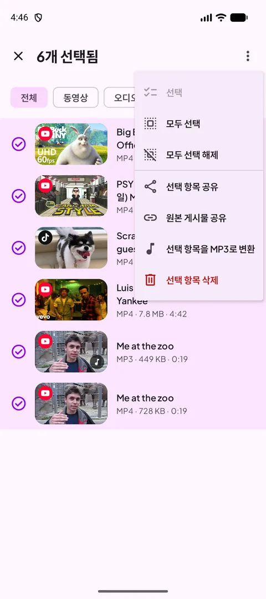
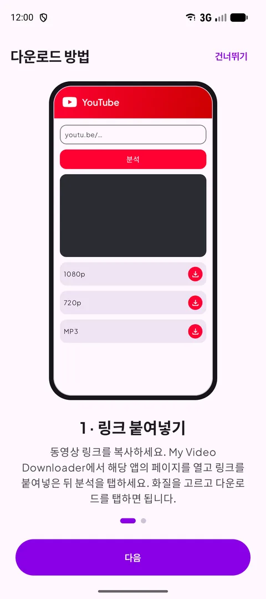

[English](README.md) · [Français](README.fr.md) · [العربية](README.ar.md) · [中文](README.zh.md) · [日本語](README.ja.md) · [עברית](README.he.md) · [हिन्दी](README.hi.md) · **한국어** · [Italiano](README.it.md) · [Português](README.pt.md) · [Español](README.es.md) · [Deutsch](README.de.md) · [Русский](README.ru.md)

### 좋아하는 앱의 동영상, 쇼츠, 스토리를 다운로드하세요 — 최대 4K 또는 MP3로.

   

Android 12 이상 · 무료 · 계정 불필요

## 📸 스크린샷

<table align="center"><tr>
<td align="center" valign="top"> <b>소스 선택</b></td><td align="center" valign="top"> <b>화질 선택</b></td><td align="center" valign="top"> <b>길게 누르기 메뉴</b></td>
</tr><tr>
<td align="center" valign="top"> <b>메뉴</b></td><td align="center" valign="top"> <b>재생목록</b></td><td align="center" valign="top"> <b>설정</b></td>
</tr></table>

## ✨ 기능

- **1.1의 새로운 기능** — 훨씬 빨라진 분석(유튜브), 재생목록 다중 선택, MP3 변환 진행률 %, 플레이어 화면 꺼짐 방지와 세로/가로 버튼, Wi-Fi 전용 알림, 러시아어.
- **주요 플랫폼 모두 지원** — YouTube, X, Instagram, Facebook, Threads, Snapchat, TikTok, Kick 및 대부분의 웹사이트.
- **최대 4K** — 사용 가능한 모든 화질을 다운로드 전 파일 크기와 함께 표시.
- **오디오만** — 128~320kbps MP3 또는 원본 M4A.
- **공유해서 다운로드** — 어떤 앱에서든 링크를 공유하면 알맞은 페이지가 화질과 함께 열립니다.
- **재생목록** — 재생, 공유, MP3 변환, 삭제. Download 폴더와 항상 동기화됩니다.
- **라이트/다크 모드**, **13개 언어**, Wi-Fi 전용 다운로드, 내장 플레이어.
- **언제나 작동** — 웹사이트가 바뀌면 다운로드 엔진이 스스로 업데이트됩니다.

## 🌐 지원 사이트

       

<i>…그리고 동영상이 있는 대부분의 웹사이트.</i>

## 📖 다운로드 방법

### 방법 1 — 링크 붙여넣기

1. 동영상 앱에서 링크를 복사합니다(**공유 → 링크 복사**).
2. My Video Downloader에서 플랫폼 버튼을 탭하고 링크를 붙여넣은 뒤 **분석**을 탭합니다.
3. 동영상 화질 또는 **오디오** 탭을 고르고 **다운로드**를 탭합니다.
4. 파일은 **Download/My Video Downloader**에 저장되고 **재생목록**에 표시됩니다.

<table align="center"><tr>
<td align="center" valign="top"> <b>소스 선택</b></td><td align="center" valign="top"> <b>붙여넣고 분석</b></td><td align="center" valign="top"> <b>화질 선택</b></td><td align="center" valign="top"> <b>재생목록</b></td>
</tr></table>

### 방법 2 — 앱에서 공유하기

1. YouTube, TikTok, Instagram, 브라우저 등에서 **공유**를 탭하고 **My Video Downloader**를 선택합니다.
2. 알맞은 페이지가 열리고 링크가 자동으로 분석됩니다.
3. 화질을 고르고 **다운로드**를 탭합니다.

<table align="center"><tr>
<td align="center" valign="top"> <b>공유 → My Video Downloader</b></td><td align="center" valign="top"> <b>화질 선택</b></td><td align="center" valign="top"> <b>내장 사용 방법</b></td>
</tr></table>

> 💡 팁: 홈 화면 상단 입력란은 어떤 링크든 받아서 알맞은 페이지를 자동으로 엽니다.

## 📲 설치

1. **[Releases](https://github.com/Oussama4422/Myvideodownloader/releases/latest)** 페이지에서 APK를 다운로드합니다.
2. 파일을 열고 Android가 요청하면 이 출처의 앱 설치를 허용합니다.
3. 끝 — 업데이트는 앱 안에서 안내됩니다.

| 파일 | 대상 |
|---|---|
| [`MyVideoDownloader-vX.Y.Z-arm64-v8a.apk`](https://github.com/Oussama4422/Myvideodownloader/releases/latest) ⭐ | 대부분의 휴대전화(권장) |
| [`MyVideoDownloader-vX.Y.Z-armeabi-v7a.apk`](https://github.com/Oussama4422/Myvideodownloader/releases/latest) | 오래된 32비트 휴대전화 |
| [`MyVideoDownloader-vX.Y.Z-x86_64.apk`](https://github.com/Oussama4422/Myvideodownloader/releases/latest) | 에뮬레이터, Chromebook |
| [`MyVideoDownloader-vX.Y.Z-universal.apk`](https://github.com/Oussama4422/Myvideodownloader/releases/latest) | 모든 기기(파일이 큼) |

## 🎨 더 보기

<table align="center"><tr>
<td align="center" valign="top"> <b>다중 선택 메뉴</b></td><td align="center" valign="top"> <b>MP3로 변환</b></td><td align="center" valign="top"> <b>내장 플레이어</b></td><td align="center" valign="top"> <b>Wi-Fi 전용 알림</b></td>
</tr><tr>
<td align="center" valign="top"> <b>다크 모드</b></td><td align="center" valign="top"> <b>MP3로 변환</b></td><td align="center" valign="top"> <b>내장 사용 방법</b></td><td align="center" valign="top"> <b>프로젝트 후원</b></td>
</tr></table>

## 🌍 13개 언어 지원

앱은 휴대전화 언어를 자동으로 따릅니다(기본값 영어). 메뉴에서 바꿀 수도 있습니다.

<table align="center"><tr>
<td align="center"> English</td>
<td align="center"> Français</td>
<td align="center"> العربية</td>
<td align="center"> 中文</td>
<td align="center"> 日本語</td>
<td align="center"> עברית</td>
<td align="center"> हिन्दी</td>
</tr><tr>
<td align="center"> 한국어</td>
<td align="center"> Italiano</td>
<td align="center"> Português</td>
<td align="center"> Español</td>
<td align="center"> Deutsch</td>
<td align="center"> Русский</td>
</tr></table>

## ❓ 자주 묻는 질문

<b>무료인가요?</b>

네. 계정도 구독도 필요 없습니다.

<b>어떤 APK를 골라야 하나요?</b>

**arm64-v8a**는 Android 12 이상인 거의 모든 휴대전화에서 작동합니다. 설치되지 않으면 **universal**을 받으세요.

<b>왜 Google Play에 없나요?</b>

Google Play는 YouTube 동영상을 다운로드하는 앱을 허용하지 않아, 이곳과 videodownloader.my에서 배포합니다.

<b>비공개 동영상이나 스토리도 받을 수 있나요?</b>

공개 콘텐츠만 가능합니다. 계정이 필요한 비공개 게시물과 스토리는 다운로드할 수 없습니다.

<b>파일은 어디에 있나요?</b>

휴대전화의 **Download/My Video Downloader** 폴더와 앱의 **재생목록**에 있습니다.

## 💜 프로젝트 후원

My Video Downloader는 무료입니다. 도움이 되셨다면 개발을 후원해 주세요:

 PayPal — 이 이메일 주소로 보내 주세요: <code>elsouad212@gmail.com</code>

 <b>Bitcoin (BTC)</b> <code>bc1qv7h60rf3yrcq2lgdqd9m74ezltchzxvw7lfcgd</code>

## 🔗 링크

- 🌐 웹사이트 — https://videodownloader.my
- 🖥️ Windows용 File Download Manager — https://filedownloadmanager.com/

---

저장할 권리가 있는 콘텐츠만 다운로드하세요. 플랫폼 이름과 로고는 각 소유자의 것입니다.
