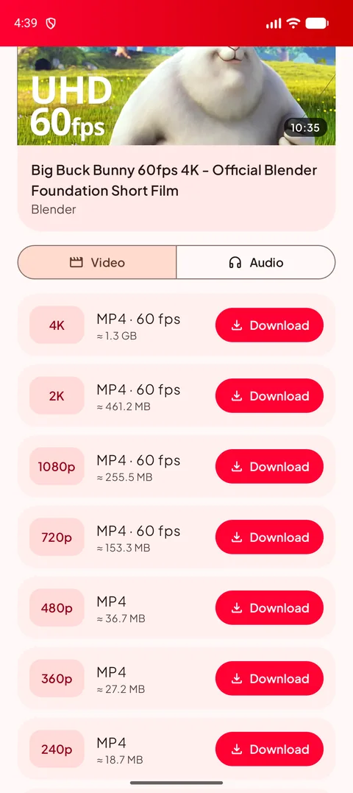
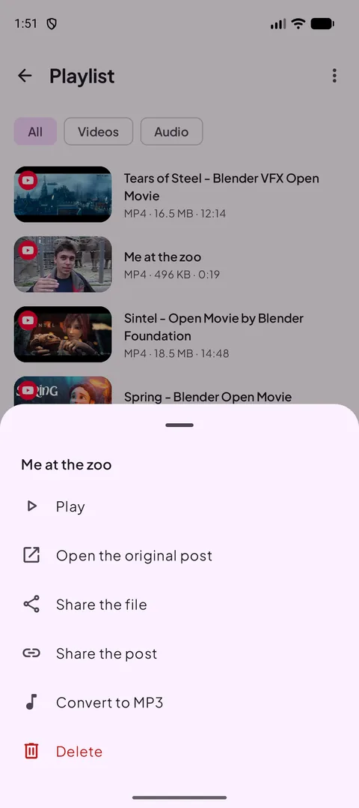
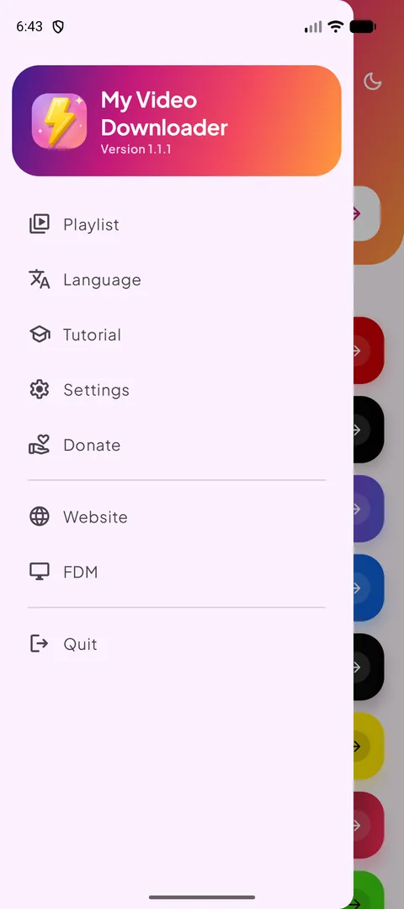
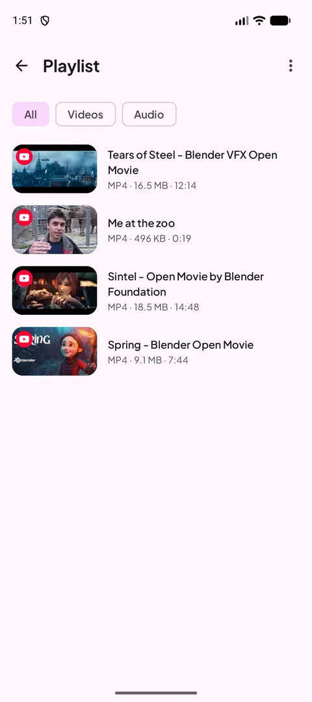
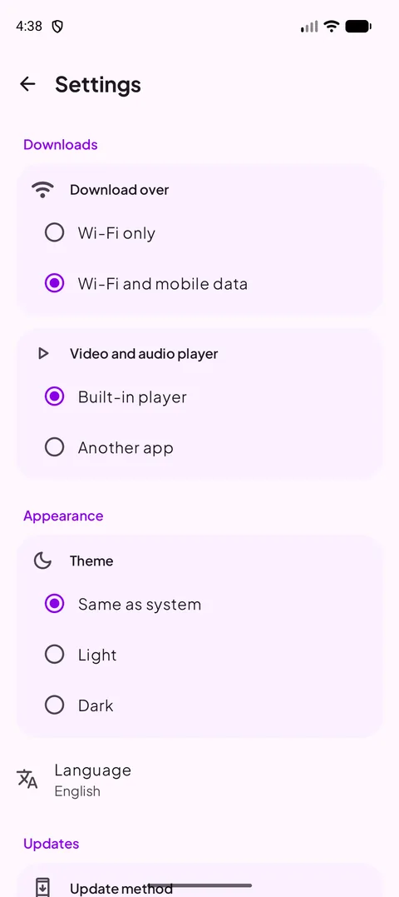
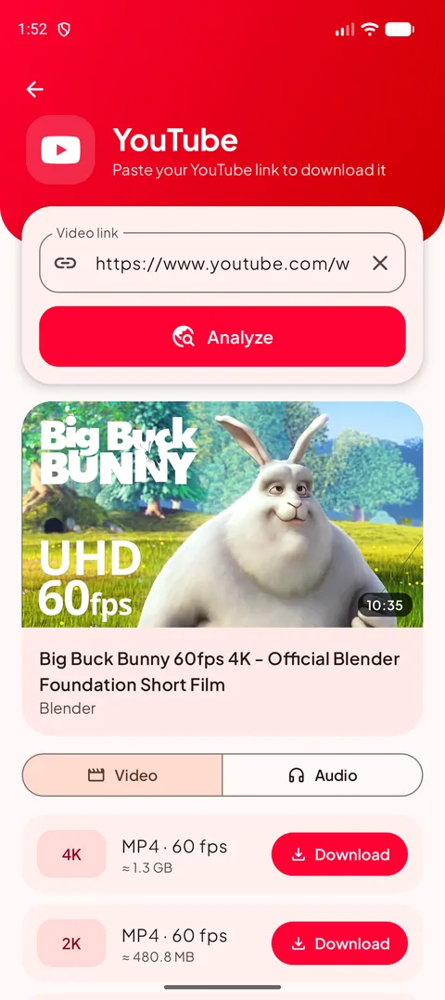
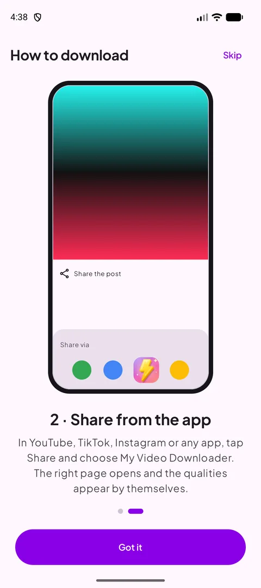
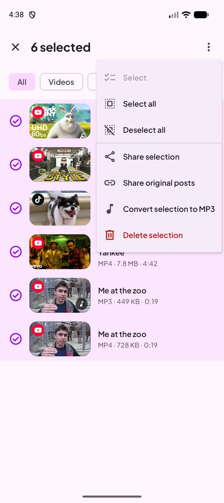
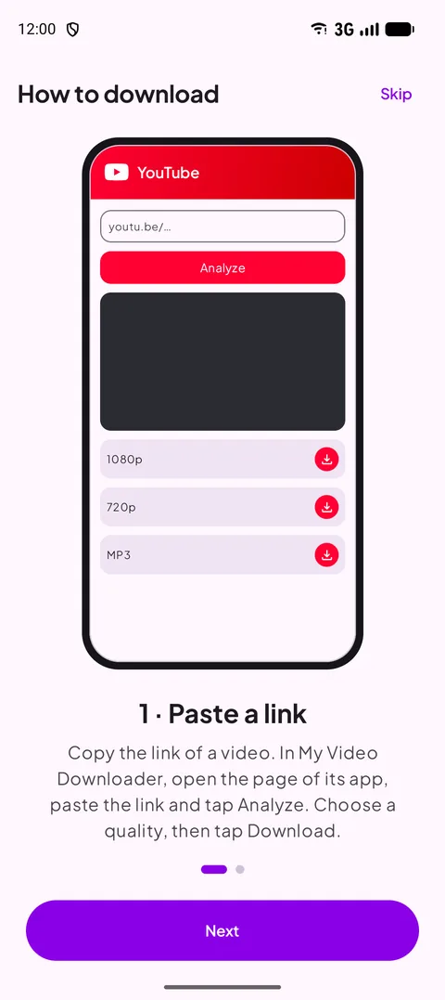

**English** · [Français](README.fr.md) · [العربية](README.ar.md) · [中文](README.zh.md) · [日本語](README.ja.md) · [עברית](README.he.md) · [हिन्दी](README.hi.md) · [한국어](README.ko.md) · [Italiano](README.it.md) · [Português](README.pt.md) · [Español](README.es.md) · [Deutsch](README.de.md) · [Русский](README.ru.md)

### Download videos, shorts and stories from your favorite apps — up to 4K, or as MP3.

   

Android 12 or newer · free · no account

## 📸 Screenshots

<table align="center"><tr>
<td align="center" valign="top"> <b>Choose a source</b></td><td align="center" valign="top"> <b>Pick a quality</b></td><td align="center" valign="top"> <b>Long-press actions</b></td>
</tr><tr>
<td align="center" valign="top"> <b>Menu</b></td><td align="center" valign="top"> <b>Your playlist</b></td><td align="center" valign="top"> <b>Settings</b></td>
</tr></table>

## ✨ Features

- **New in 1.1** — much faster analysis (YouTube), multi-select in the Playlist, MP3 progress in %, screen kept on in the player with a portrait/landscape button, Wi-Fi only alert and Russian.
- **Every big platform** — YouTube, X, Instagram, Facebook, Threads, Snapchat, TikTok, Kick and most other websites.
- **Up to 4K** — every available quality, with the file size shown before you download.
- **Audio only** — MP3 from 128 to 320 kbps, or the original M4A.
- **Share to download** — share a link from any app: the right page opens with the qualities ready.
- **Playlist** — play, share, convert to MP3 or delete; it stays in sync with your Download folder.
- **Light and dark mode**, **13 languages**, Wi-Fi-only downloads and a built-in player.
- **Always working** — the download engine updates itself as websites change.

## 🌐 Supported sites

       

<i>…and most websites that show a video.</i>

## 📖 How to download

### Method 1 — Paste a link

1. Copy the link of the video in its app (**Share → Copy link**).
2. In My Video Downloader, tap the platform's button, paste the link and tap **Analyze**.
3. Choose a video quality or the **Audio** tab, then tap **Download**.
4. The file is saved in **Download/My Video Downloader** and appears in the **Playlist**.

<table align="center"><tr>
<td align="center" valign="top"> <b>Choose a source</b></td><td align="center" valign="top"> <b>Paste & analyze</b></td><td align="center" valign="top"> <b>Pick a quality</b></td><td align="center" valign="top"> <b>Your playlist</b></td>
</tr></table>

### Method 2 — Share from the app

1. In YouTube, TikTok, Instagram, your browser… tap **Share** and choose **My Video Downloader**.
2. The right page opens and the link is analyzed automatically.
3. Pick a quality and tap **Download**.

<table align="center"><tr>
<td align="center" valign="top"> <b>Share → My Video Downloader</b></td><td align="center" valign="top"> <b>Pick a quality</b></td><td align="center" valign="top"> <b>Built-in tutorial</b></td>
</tr></table>

> 💡 Tip: the field at the top of the home screen accepts any link and opens the right page by itself.

## 📲 Installation

1. Download the APK from the **[Releases](https://github.com/Oussama4422/Myvideodownloader/releases/latest)** page.
2. Open the file and allow installing apps from this source if Android asks.
3. That's it — updates are offered inside the app.

| File | For |
|---|---|
| [`MyVideoDownloader-vX.Y.Z-arm64-v8a.apk`](https://github.com/Oussama4422/Myvideodownloader/releases/latest) ⭐ | Most phones (recommended) |
| [`MyVideoDownloader-vX.Y.Z-armeabi-v7a.apk`](https://github.com/Oussama4422/Myvideodownloader/releases/latest) | Older 32-bit phones |
| [`MyVideoDownloader-vX.Y.Z-x86_64.apk`](https://github.com/Oussama4422/Myvideodownloader/releases/latest) | Emulators, Chromebooks |
| [`MyVideoDownloader-vX.Y.Z-universal.apk`](https://github.com/Oussama4422/Myvideodownloader/releases/latest) | Any device (larger file) |

## 🎨 More

<table align="center"><tr>
<td align="center" valign="top"> <b>Multi-select menu</b></td><td align="center" valign="top"> <b>Convert to MP3</b></td><td align="center" valign="top"> <b>Built-in player</b></td><td align="center" valign="top"> <b>Wi-Fi only alert</b></td>
</tr><tr>
<td align="center" valign="top"> <b>Dark mode</b></td><td align="center" valign="top"> <b>Convert to MP3</b></td><td align="center" valign="top"> <b>Built-in tutorial</b></td><td align="center" valign="top"> <b>Support the project</b></td>
</tr></table>

## 🌍 Available in 13 languages

The app follows your phone's language automatically (English by default). You can also change it from the menu.

<table align="center"><tr>
<td align="center"> English</td>
<td align="center"> Français</td>
<td align="center"> العربية</td>
<td align="center"> 中文</td>
<td align="center"> 日本語</td>
<td align="center"> עברית</td>
<td align="center"> हिन्दी</td>
</tr><tr>
<td align="center"> 한국어</td>
<td align="center"> Italiano</td>
<td align="center"> Português</td>
<td align="center"> Español</td>
<td align="center"> Deutsch</td>
<td align="center"> Русский</td>
</tr></table>

## ❓ FAQ

<b>Is it free?</b>

Yes. No account, no subscription.

<b>Which APK should I choose?</b>

**arm64-v8a** works on almost every phone with Android 12 or newer. If it doesn't install, take **universal**.

<b>Why isn't it on Google Play?</b>

Google Play does not allow apps that download YouTube videos, so the app is distributed here and on videodownloader.my.

<b>Can I download private videos or stories?</b>

Only public content. Private posts and stories that need an account can't be downloaded.

<b>Where are my files?</b>

In the **Download/My Video Downloader** folder of your phone, and in the app's **Playlist**.

## 💜 Support the project

My Video Downloader is free. If it helps you, you can support its development:

 PayPal — send to this e-mail address: <code>elsouad212@gmail.com</code>

 <b>Bitcoin (BTC)</b> <code>bc1qv7h60rf3yrcq2lgdqd9m74ezltchzxvw7lfcgd</code>

## 🔗 Links

- 🌐 Website — https://videodownloader.my
- 🖥️ File Download Manager for Windows — https://filedownloadmanager.com/

---

Download only content you have the right to save. Platform names and logos belong to their owners.
