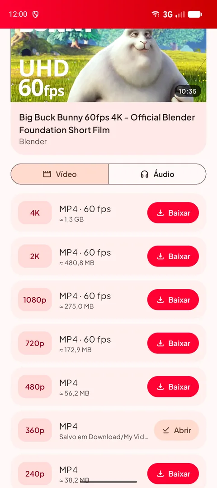
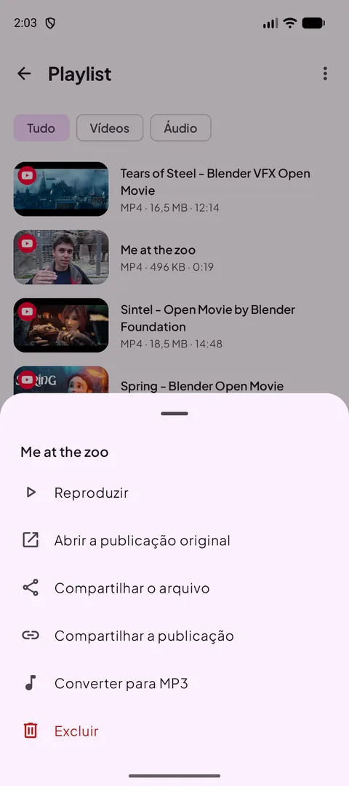
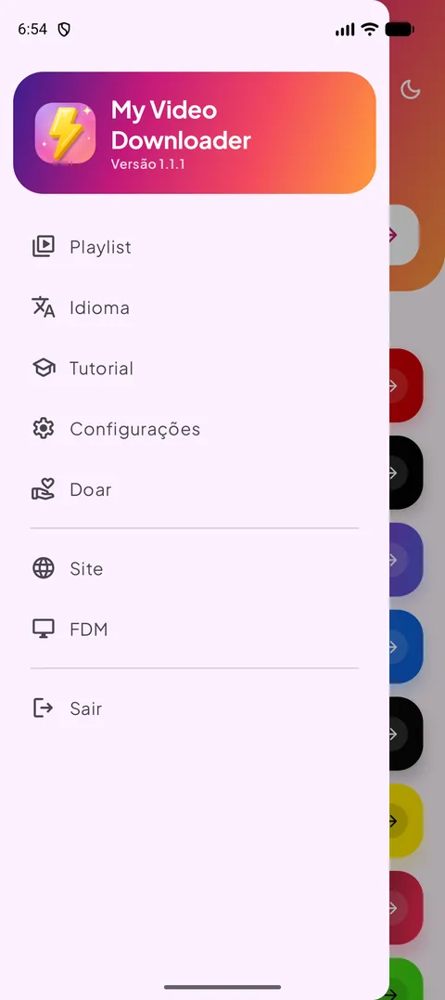
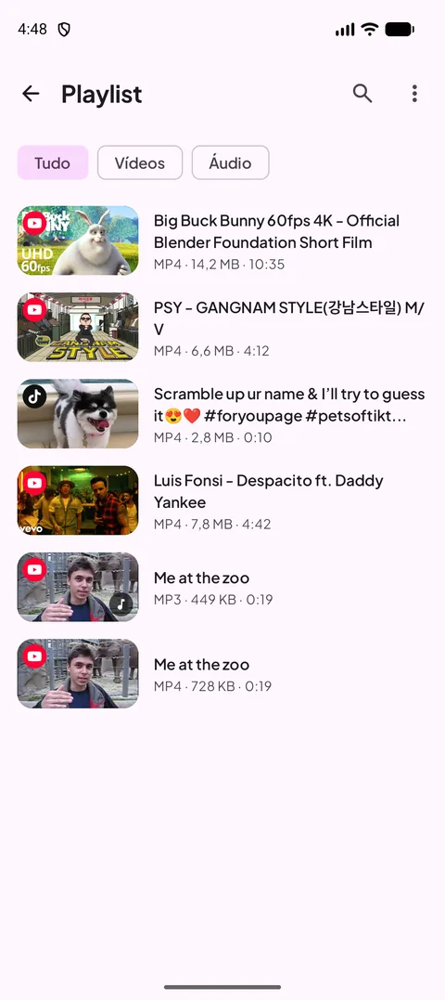
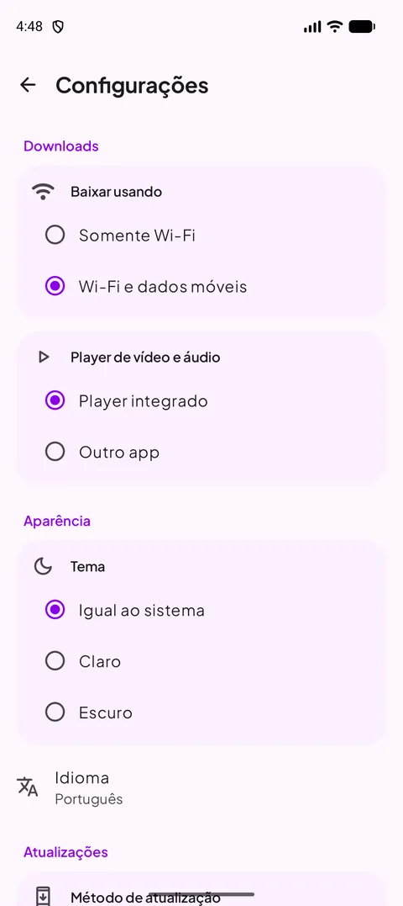
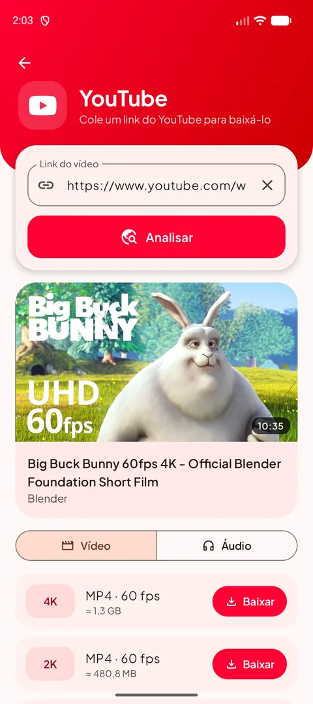
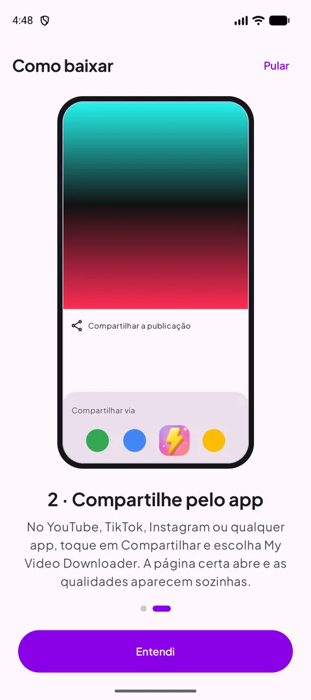
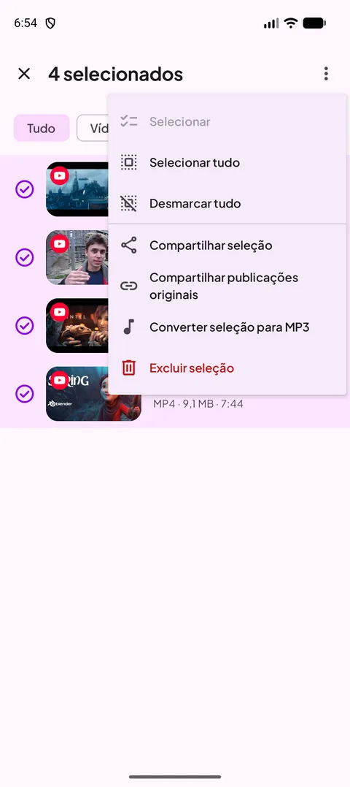
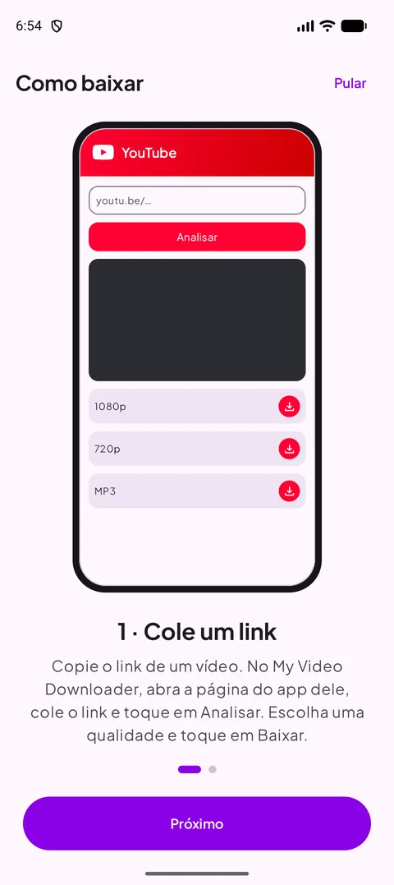

[English](README.md) · [Français](README.fr.md) · [العربية](README.ar.md) · [中文](README.zh.md) · [日本語](README.ja.md) · [עברית](README.he.md) · [हिन्दी](README.hi.md) · [한국어](README.ko.md) · [Italiano](README.it.md) · **Português** · [Español](README.es.md) · [Deutsch](README.de.md) · [Русский](README.ru.md)

### Baixe vídeos, shorts e stories dos seus apps favoritos — até 4K, ou em MP3.

   

Android 12 ou mais recente · grátis · sem conta

## 📸 Capturas de tela

<table align="center"><tr>
<td align="center" valign="top"> <b>Escolha uma fonte</b></td><td align="center" valign="top"> <b>Escolha a qualidade</b></td><td align="center" valign="top"> <b>Ações ao tocar e segurar</b></td>
</tr><tr>
<td align="center" valign="top"> <b>Menu</b></td><td align="center" valign="top"> <b>Sua playlist</b></td><td align="center" valign="top"> <b>Configurações</b></td>
</tr></table>

## ✨ Recursos

- **Novo na 1.1** — análise muito mais rápida (YouTube), seleção múltipla na playlist, progresso do MP3 em %, tela ligada no player com botão retrato/paisagem, alerta Somente Wi-Fi e russo.
- **Todas as grandes plataformas** — YouTube, X, Instagram, Facebook, Threads, Snapchat, TikTok, Kick e a maioria dos outros sites.
- **Até 4K** — todas as qualidades disponíveis, com o tamanho do arquivo antes de baixar.
- **Só áudio** — MP3 de 128 a 320 kbps, ou o M4A original.
- **Compartilhe para baixar** — compartilhe um link de qualquer app: a página certa abre com as qualidades prontas.
- **Playlist** — reproduza, compartilhe, converta para MP3 ou exclua; ela fica sincronizada com a pasta Download.
- **Modo claro e escuro**, **13 idiomas**, download só no Wi-Fi e player integrado.
- **Sempre funcionando** — o mecanismo de download se atualiza sozinho quando os sites mudam.

## 🌐 Sites compatíveis

       

<i>…e a maioria dos sites que exibem vídeo.</i>

## 📖 Como baixar

### Método 1 — Colar um link

1. Copie o link do vídeo no app dele (**Compartilhar → Copiar link**).
2. No My Video Downloader, toque no botão da plataforma, cole o link e toque em **Analisar**.
3. Escolha uma qualidade de vídeo ou a aba **Áudio** e toque em **Baixar**.
4. O arquivo é salvo em **Download/My Video Downloader** e aparece na **Playlist**.

<table align="center"><tr>
<td align="center" valign="top"> <b>Escolha uma fonte</b></td><td align="center" valign="top"> <b>Colar e analisar</b></td><td align="center" valign="top"> <b>Escolha a qualidade</b></td><td align="center" valign="top"> <b>Sua playlist</b></td>
</tr></table>

### Método 2 — Compartilhar pelo app

1. No YouTube, TikTok, Instagram, no navegador… toque em **Compartilhar** e escolha **My Video Downloader**.
2. A página certa abre e o link é analisado automaticamente.
3. Escolha uma qualidade e toque em **Baixar**.

<table align="center"><tr>
<td align="center" valign="top"> <b>Compartilhar → My Video Downloader</b></td><td align="center" valign="top"> <b>Escolha a qualidade</b></td><td align="center" valign="top"> <b>Tutorial integrado</b></td>
</tr></table>

> 💡 Dica: o campo no topo da tela inicial aceita qualquer link e abre sozinho a página certa.

## 📲 Instalação

1. Baixe o APK na página **[Releases](https://github.com/Oussama4422/Myvideodownloader/releases/latest)**.
2. Abra o arquivo e permita a instalação desta fonte se o Android pedir.
3. Pronto — as atualizações aparecem dentro do app.

| Arquivo | Para |
|---|---|
| [`MyVideoDownloader-vX.Y.Z-arm64-v8a.apk`](https://github.com/Oussama4422/Myvideodownloader/releases/latest) ⭐ | A maioria dos celulares (recomendado) |
| [`MyVideoDownloader-vX.Y.Z-armeabi-v7a.apk`](https://github.com/Oussama4422/Myvideodownloader/releases/latest) | Celulares antigos de 32 bits |
| [`MyVideoDownloader-vX.Y.Z-x86_64.apk`](https://github.com/Oussama4422/Myvideodownloader/releases/latest) | Emuladores, Chromebooks |
| [`MyVideoDownloader-vX.Y.Z-universal.apk`](https://github.com/Oussama4422/Myvideodownloader/releases/latest) | Qualquer aparelho (arquivo maior) |

## 🎨 Mais

<table align="center"><tr>
<td align="center" valign="top"> <b>Menu de seleção</b></td><td align="center" valign="top"> <b>Converter para MP3</b></td><td align="center" valign="top"> <b>Player integrado</b></td><td align="center" valign="top"> <b>Alerta Somente Wi-Fi</b></td>
</tr><tr>
<td align="center" valign="top"> <b>Modo escuro</b></td><td align="center" valign="top"> <b>Converter para MP3</b></td><td align="center" valign="top"> <b>Tutorial integrado</b></td><td align="center" valign="top"> <b>Apoie o projeto</b></td>
</tr></table>

## 🌍 Disponível em 13 idiomas

O app segue automaticamente o idioma do seu celular (inglês por padrão). Você também pode mudar pelo menu.

<table align="center"><tr>
<td align="center"> English</td>
<td align="center"> Français</td>
<td align="center"> العربية</td>
<td align="center"> 中文</td>
<td align="center"> 日本語</td>
<td align="center"> עברית</td>
<td align="center"> हिन्दी</td>
</tr><tr>
<td align="center"> 한국어</td>
<td align="center"> Italiano</td>
<td align="center"> Português</td>
<td align="center"> Español</td>
<td align="center"> Deutsch</td>
<td align="center"> Русский</td>
</tr></table>

## ❓ Perguntas frequentes

<b>É grátis?</b>

Sim. Sem conta e sem assinatura.

<b>Qual APK devo escolher?</b>

**arm64-v8a** funciona em quase todos os celulares com Android 12 ou mais recente. Se não instalar, pegue o **universal**.

<b>Por que não está no Google Play?</b>

O Google Play não permite apps que baixam vídeos do YouTube, por isso o app é distribuído aqui e em videodownloader.my.

<b>Posso baixar vídeos ou stories privados?</b>

Só conteúdo público. Publicações privadas e stories que exigem conta não podem ser baixados.

<b>Onde ficam meus arquivos?</b>

Na pasta **Download/My Video Downloader** do celular e na **Playlist** do app.

## 💜 Apoie o projeto

O My Video Downloader é gratuito. Se ele te ajuda, você pode apoiar o desenvolvimento:

 PayPal — envie para este e-mail: <code>elsouad212@gmail.com</code>

 <b>Bitcoin (BTC)</b> <code>bc1qv7h60rf3yrcq2lgdqd9m74ezltchzxvw7lfcgd</code>

## 🔗 Links

- 🌐 Site — https://videodownloader.my
- 🖥️ File Download Manager para Windows — https://filedownloadmanager.com/

---

Baixe apenas conteúdos que você tem o direito de salvar. Os nomes e logos das plataformas pertencem aos seus donos.
