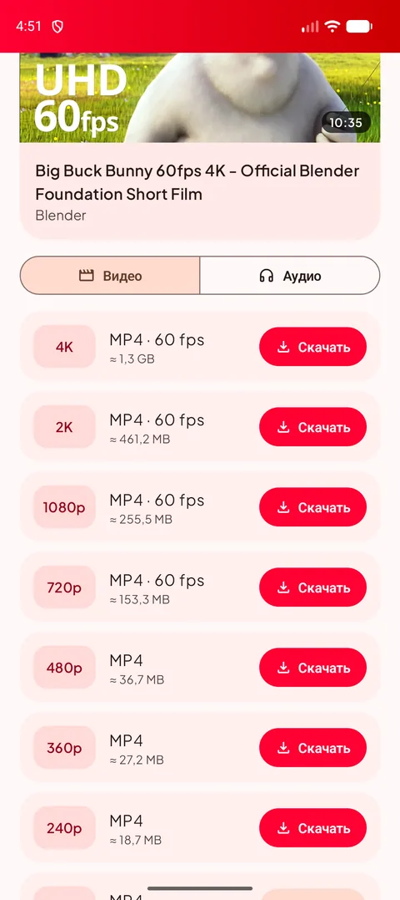
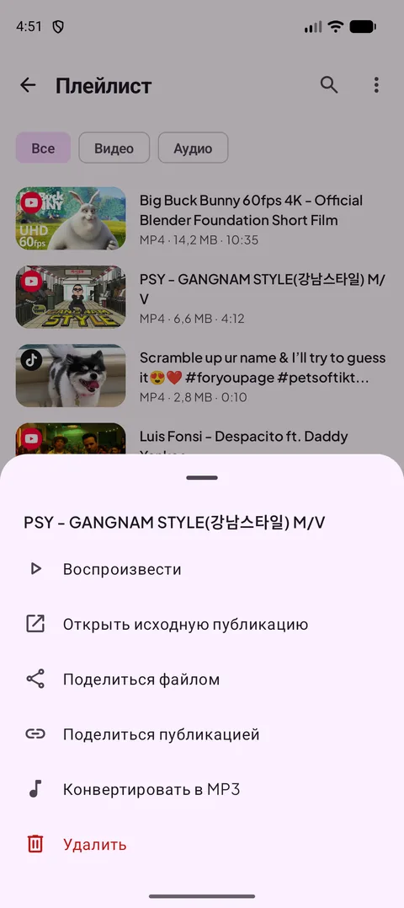
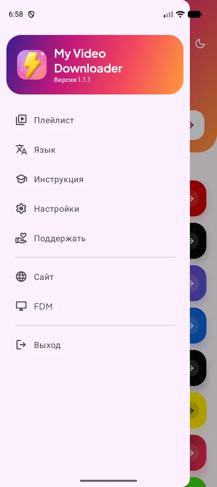
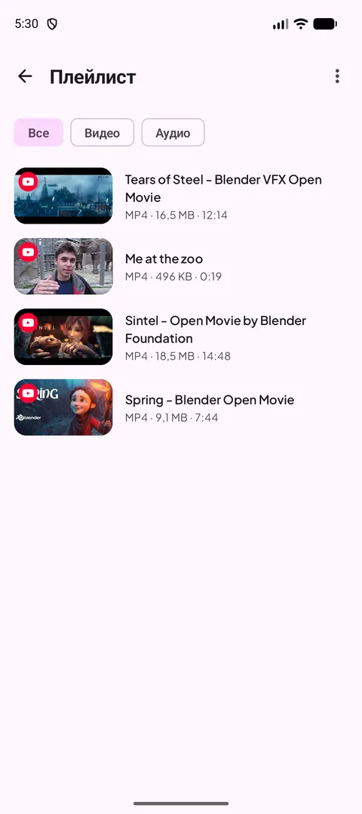
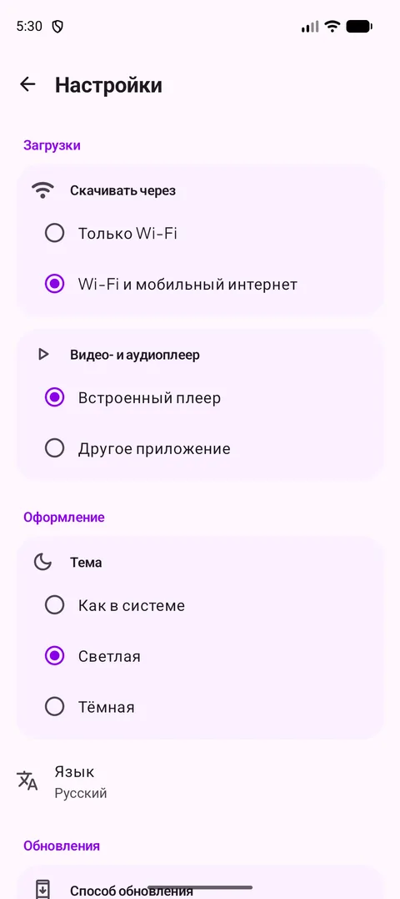
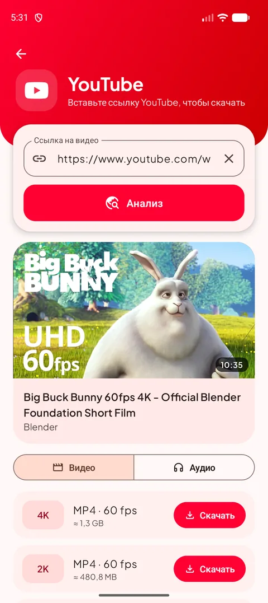
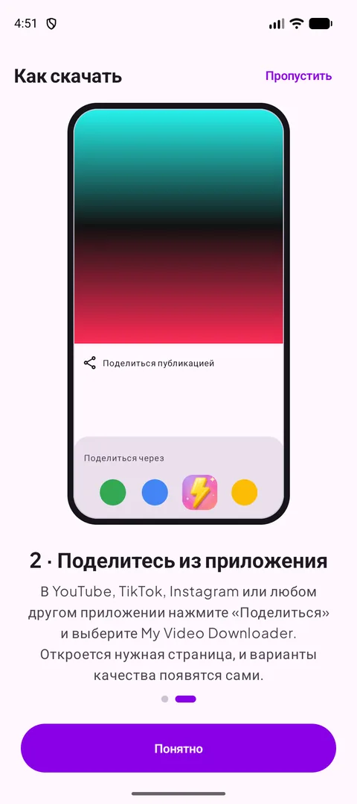
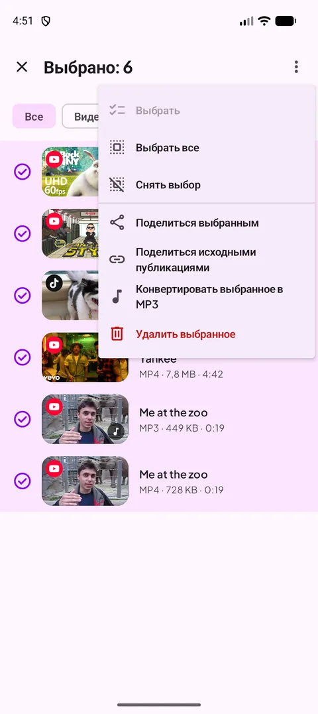
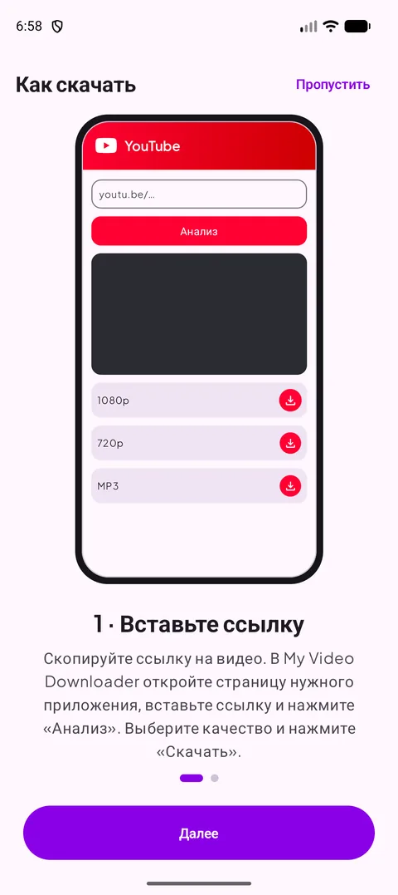

[English](README.md) · [Français](README.fr.md) · [العربية](README.ar.md) · [中文](README.zh.md) · [日本語](README.ja.md) · [עברית](README.he.md) · [हिन्दी](README.hi.md) · [한국어](README.ko.md) · [Italiano](README.it.md) · [Português](README.pt.md) · [Español](README.es.md) · [Deutsch](README.de.md) · **Русский**

### Скачивайте видео, шортсы и истории из любимых приложений — до 4K или в MP3.

   

Android 12 или новее · бесплатно · без аккаунта

## 📸 Скриншоты

<table align="center"><tr>
<td align="center" valign="top"> <b>Выберите источник</b></td><td align="center" valign="top"> <b>Выберите качество</b></td><td align="center" valign="top"> <b>Действия по долгому нажатию</b></td>
</tr><tr>
<td align="center" valign="top"> <b>Меню</b></td><td align="center" valign="top"> <b>Ваш плейлист</b></td><td align="center" valign="top"> <b>Настройки</b></td>
</tr></table>

## ✨ Возможности

- **Новое в 1.2** — анализ ссылок примерно вдвое быстрее на всех сайтах, название и картинка видео появляются сразу, поиск в плейлисте и кнопка «Поделиться приложением» в меню.
- **Новое в 1.1** — гораздо более быстрый анализ (YouTube), выбор нескольких файлов в плейлисте, прогресс MP3 в %, экран не гаснет в плеере и кнопка книжной/альбомной ориентации, предупреждение «Только Wi-Fi» и русский язык.
- **Все крупные платформы** — YouTube, X, Instagram, Facebook, Threads, Snapchat, TikTok, Kick и большинство других сайтов.
- **До 4K** — все доступные варианты качества, размер файла виден до скачивания.
- **Только звук** — MP3 от 128 до 320 кбит/с или исходный M4A.
- **Поделиться, чтобы скачать** — поделитесь ссылкой из любого приложения: откроется нужная страница с готовыми вариантами качества.
- **Плейлист** — воспроизводите, отправляйте, конвертируйте в MP3 или удаляйте; он синхронизирован с папкой Download.
- **Светлая и тёмная тема**, **13 языков**, загрузка только по Wi-Fi и встроенный плеер.
- **Всегда работает** — движок загрузки обновляется сам, когда сайты меняются.

## 🌐 Поддерживаемые сайты

       

<i>…и большинство сайтов, где есть видео.</i>

## 📖 Как скачать

### Способ 1 — вставить ссылку

1. Скопируйте ссылку на видео в его приложении (**Поделиться → Копировать ссылку**).
2. В My Video Downloader нажмите кнопку платформы, вставьте ссылку и нажмите **Анализ**.
3. Выберите качество видео или вкладку **Аудио**, затем нажмите **Скачать**.
4. Файл сохраняется в **Download/My Video Downloader** и появляется в **плейлисте**.

<table align="center"><tr>
<td align="center" valign="top"> <b>Выберите источник</b></td><td align="center" valign="top"> <b>Вставить и проанализировать</b></td><td align="center" valign="top"> <b>Выберите качество</b></td><td align="center" valign="top"> <b>Ваш плейлист</b></td>
</tr></table>

### Способ 2 — поделиться из приложения

1. В YouTube, TikTok, Instagram, браузере… нажмите **Поделиться** и выберите **My Video Downloader**.
2. Откроется нужная страница, и ссылка будет проанализирована автоматически.
3. Выберите качество и нажмите **Скачать**.

<table align="center"><tr>
<td align="center" valign="top"> <b>Поделиться → My Video Downloader</b></td><td align="center" valign="top"> <b>Выберите качество</b></td><td align="center" valign="top"> <b>Встроенная инструкция</b></td>
</tr></table>

> 💡 Совет: поле вверху главного экрана принимает любую ссылку и само открывает нужную страницу.

## 📲 Установка

1. Скачайте APK на странице **[Releases](https://github.com/Oussama4422/Myvideodownloader/releases/latest)** или на https://videodownloader.my.
2. Откройте файл и разрешите установку из этого источника, если Android попросит.
3. Готово — обновления предлагаются прямо в приложении.

| Файл | Для |
|---|---|
| [`MyVideoDownloader-vX.Y.Z-arm64-v8a.apk`](https://github.com/Oussama4422/Myvideodownloader/releases/latest) ⭐ | Большинство телефонов (рекомендуется) |
| [`MyVideoDownloader-vX.Y.Z-armeabi-v7a.apk`](https://github.com/Oussama4422/Myvideodownloader/releases/latest) | Старые 32-битные телефоны |
| [`MyVideoDownloader-vX.Y.Z-x86_64.apk`](https://github.com/Oussama4422/Myvideodownloader/releases/latest) | Эмуляторы, Chromebook |
| [`MyVideoDownloader-vX.Y.Z-universal.apk`](https://github.com/Oussama4422/Myvideodownloader/releases/latest) | Любое устройство (файл больше) |

## 🎨 Ещё

<table align="center"><tr>
<td align="center" valign="top"> <b>Меню выбора</b></td><td align="center" valign="top"> <b>Конвертация в MP3</b></td><td align="center" valign="top"> <b>Встроенный плеер</b></td><td align="center" valign="top"> <b>Предупреждение «Только Wi-Fi»</b></td>
</tr><tr>
<td align="center" valign="top"> <b>Тёмная тема</b></td><td align="center" valign="top"> <b>Конвертация в MP3</b></td><td align="center" valign="top"> <b>Встроенная инструкция</b></td><td align="center" valign="top"> <b>Поддержать проект</b></td>
</tr></table>

## 🌍 Доступно на 13 языках

Приложение автоматически использует язык телефона (по умолчанию английский). Язык можно сменить и в меню.

<table align="center"><tr>
<td align="center"> English</td>
<td align="center"> Français</td>
<td align="center"> العربية</td>
<td align="center"> 中文</td>
<td align="center"> 日本語</td>
<td align="center"> עברית</td>
<td align="center"> हिन्दी</td>
</tr><tr>
<td align="center"> 한국어</td>
<td align="center"> Italiano</td>
<td align="center"> Português</td>
<td align="center"> Español</td>
<td align="center"> Deutsch</td>
<td align="center"> Русский</td>
</tr></table>

## ❓ Вопросы и ответы

<b>Это бесплатно?</b>

Да. Без аккаунта и без подписки.

<b>Какой APK выбрать?</b>

**arm64-v8a** работает почти на всех телефонах с Android 12 и новее. Если не устанавливается, возьмите **universal**.

<b>Почему приложения нет в Google Play?</b>

Google Play не допускает приложения, которые скачивают видео с YouTube, поэтому приложение распространяется здесь и на videodownloader.my.

<b>Можно ли скачать закрытые видео или истории?</b>

Только общедоступный контент. Закрытые публикации и истории, требующие аккаунта, скачать нельзя.

<b>Где мои файлы?</b>

В папке **Download/My Video Downloader** на телефоне и в **плейлисте** приложения.

## 💜 Поддержать проект

My Video Downloader бесплатно. Если оно вам помогает, вы можете поддержать разработку:

 PayPal — отправьте на этот адрес электронной почты: <code>elsouad212@gmail.com</code>

 <b>Bitcoin (BTC)</b> <code>bc1qv7h60rf3yrcq2lgdqd9m74ezltchzxvw7lfcgd</code>

## 🔗 Ссылки

- 🌐 Сайт — https://videodownloader.my
- 🖥️ File Download Manager для Windows — https://filedownloadmanager.com/

---

Скачивайте только то, что имеете право сохранять. Названия и логотипы платформ принадлежат их владельцам.
