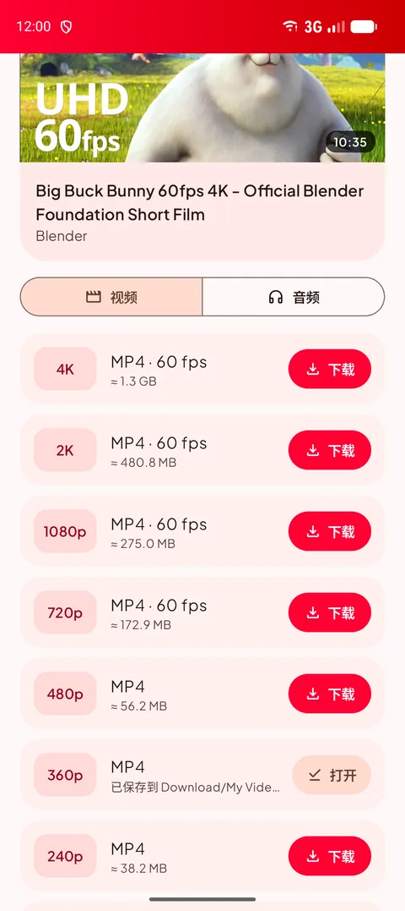
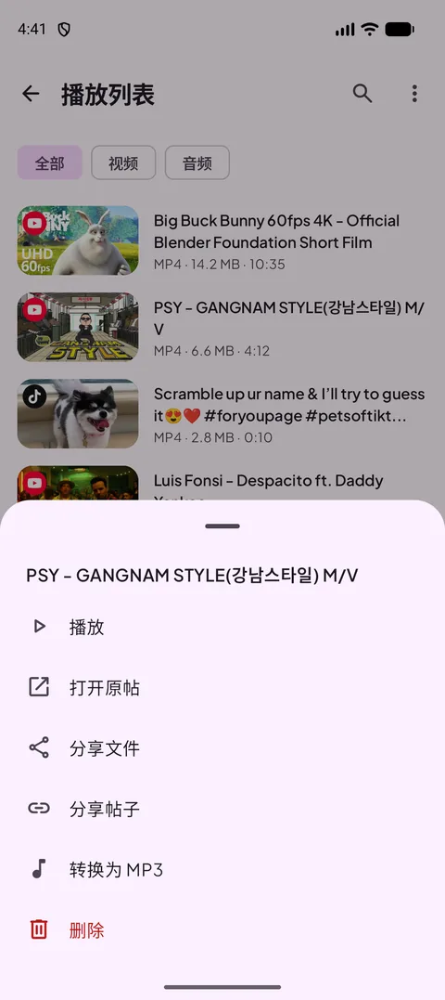
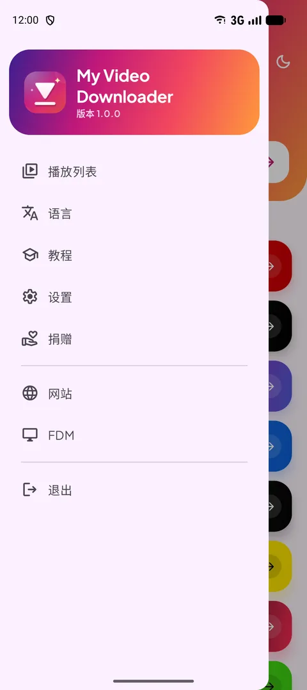
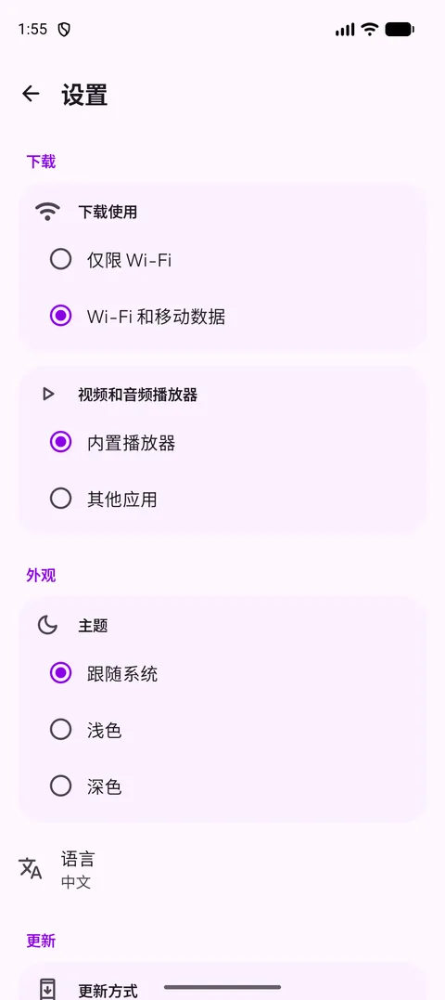
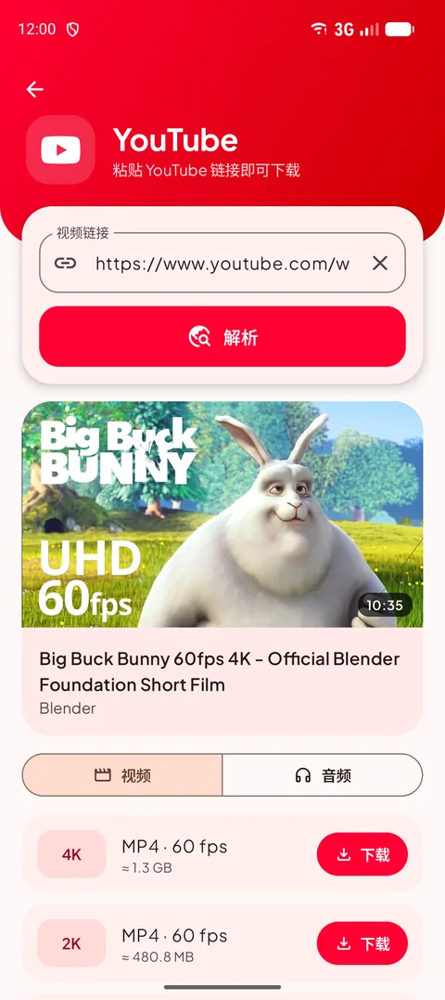
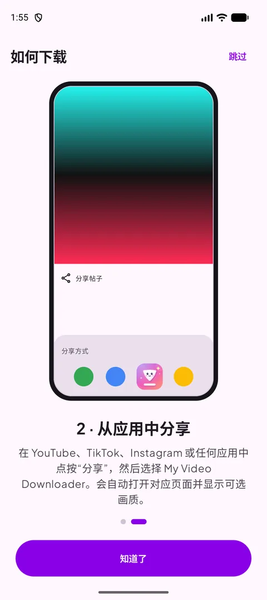
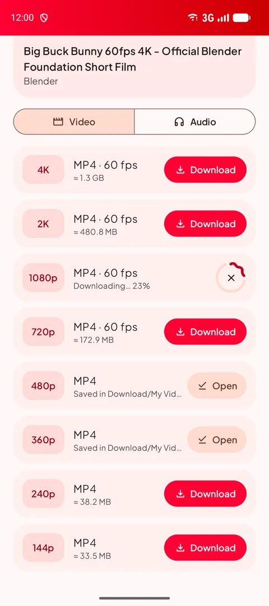
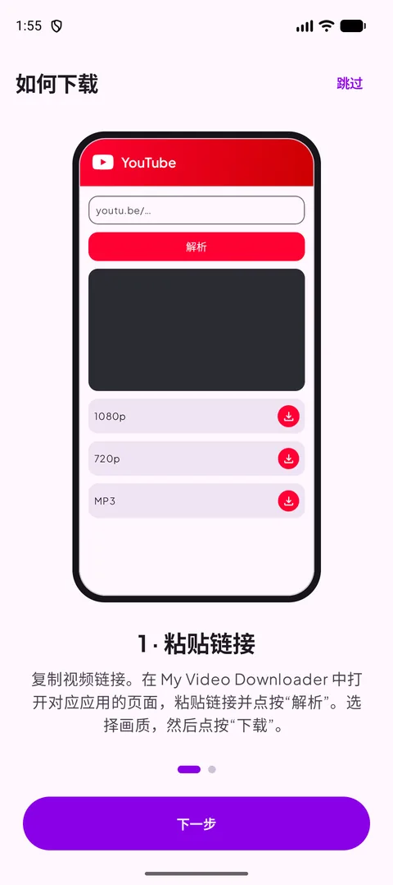

[English](README.md) · [Français](README.fr.md) · [العربية](README.ar.md) · **中文** · [日本語](README.ja.md) · [עברית](README.he.md) · [हिन्दी](README.hi.md) · [한국어](README.ko.md) · [Italiano](README.it.md) · [Português](README.pt.md) · [Español](README.es.md) · [Deutsch](README.de.md)

### 下载你喜爱应用中的视频、短视频和快拍——最高 4K，或保存为 MP3。

   

Android 14 或更高版本 · 免费 · 无需账号

## 📸 截图

<table align="center"><tr>
<td align="center" valign="top"> <b>选择来源</b></td><td align="center" valign="top"> <b>选择画质</b></td><td align="center" valign="top"> <b>长按操作</b></td>
</tr><tr>
<td align="center" valign="top"> <b>菜单</b></td><td align="center" valign="top"> <b>播放列表</b></td><td align="center" valign="top"> <b>设置</b></td>
</tr></table>

## ✨ 功能

- **支持各大平台**——YouTube、X、Instagram、Facebook、Threads、Snapchat、TikTok、Kick 以及大多数其他网站。
- **最高 4K**——列出所有可用画质，下载前即可看到文件大小。
- **仅音频**——128 至 320 kbps 的 MP3，或原始 M4A。
- **分享即下载**——从任意应用分享链接，自动打开对应页面并列出画质。
- **播放列表**——播放、分享、转换为 MP3 或删除，并与 Download 文件夹保持同步。
- **浅色/深色模式**、**12 种语言**、仅 Wi-Fi 下载和内置播放器。
- **始终可用**——网站变化时，下载引擎会自动更新。

## 🌐 支持的网站

       

<i>……以及大多数包含视频的网站。</i>

## 📖 如何下载

### 方法 1 — 粘贴链接

1. 在视频所在的应用中复制链接（**分享 → 复制链接**）。
2. 在 My Video Downloader 中点按对应平台的按钮，粘贴链接并点按 **解析**。
3. 选择视频画质或 **音频** 标签，然后点按 **下载**。
4. 文件会保存到 **Download/My Video Downloader**，并显示在 **播放列表** 中。

<table align="center"><tr>
<td align="center" valign="top"> <b>选择来源</b></td><td align="center" valign="top"> <b>粘贴并解析</b></td><td align="center" valign="top"> <b>选择画质</b></td><td align="center" valign="top"> <b>播放列表</b></td>
</tr></table>

### 方法 2 — 从应用中分享

1. 在 YouTube、TikTok、Instagram 或浏览器中点按 **分享**，然后选择 **My Video Downloader**。
2. 会自动打开对应页面并解析链接。
3. 选择画质并点按 **下载**。

<table align="center"><tr>
<td align="center" valign="top"> <b>分享 → My Video Downloader</b></td><td align="center" valign="top"> <b>选择画质</b></td><td align="center" valign="top"> <b>内置教程</b></td>
</tr></table>

> 💡 提示：主页顶部的输入框可接受任意链接，并会自动打开对应页面。

## 📲 安装

1. 从 **[Releases](https://github.com/Oussama4422/Myvideodownloader/releases/latest)** 页面下载 APK。
2. 打开文件；如果 Android 提示，请允许从此来源安装应用。
3. 完成——应用内会提示更新。

| 文件 | 适用于 |
|---|---|
| [`MyVideoDownloader-vX.Y.Z-arm64-v8a.apk`](https://github.com/Oussama4422/Myvideodownloader/releases/latest) ⭐ | 大多数手机（推荐） |
| [`MyVideoDownloader-vX.Y.Z-armeabi-v7a.apk`](https://github.com/Oussama4422/Myvideodownloader/releases/latest) | 较旧的 32 位手机 |
| [`MyVideoDownloader-vX.Y.Z-x86_64.apk`](https://github.com/Oussama4422/Myvideodownloader/releases/latest) | 模拟器、Chromebook |
| [`MyVideoDownloader-vX.Y.Z-universal.apk`](https://github.com/Oussama4422/Myvideodownloader/releases/latest) | 所有设备（文件较大） |

## 🎨 更多

<table align="center"><tr>
<td align="center" valign="top"> <b>深色模式</b></td><td align="center" valign="top"> <b>正在下载</b></td><td align="center" valign="top"> <b>转换为 MP3</b></td><td align="center" valign="top"> <b>内置教程</b></td>
</tr></table>

## 🌍 支持 12 种语言

应用会自动跟随手机语言（默认英语），也可以在菜单中更改。

<table align="center"><tr>
<td align="center"> English</td>
<td align="center"> Français</td>
<td align="center"> العربية</td>
<td align="center"> 中文</td>
<td align="center"> 日本語</td>
<td align="center"> עברית</td>
</tr><tr>
<td align="center"> हिन्दी</td>
<td align="center"> 한국어</td>
<td align="center"> Italiano</td>
<td align="center"> Português</td>
<td align="center"> Español</td>
<td align="center"> Deutsch</td>
</tr></table>

## ❓ 常见问题

<b>是免费的吗？</b>

是的。无需账号，也没有订阅。

<b>该选择哪个 APK？</b>

**arm64-v8a** 适用于几乎所有 Android 14 及以上的手机。如果无法安装，请选择 **universal**。

<b>为什么不在 Google Play 上架？</b>

Google Play 不允许下载 YouTube 视频的应用，因此本应用在这里和 videodownloader.my 发布。

<b>可以下载私密视频或快拍吗？</b>

只能下载公开内容。需要登录账号的私密帖子和快拍无法下载。

<b>文件保存在哪里？</b>

保存在手机的 **Download/My Video Downloader** 文件夹中，也会显示在应用的 **播放列表** 里。

## 💜 支持本项目

My Video Downloader 是免费的。如果它对你有帮助，你可以支持它的开发：

 <b>Bitcoin (BTC)</b> <code>bc1qv7h60rf3yrcq2lgdqd9m74ezltchzxvw7lfcgd</code>

## 🔗 链接

- 🌐 网站 — https://videodownloader.my
- 🖥️ Windows 版 File Download Manager — https://filedownloadmanager.com/

---

请仅下载你有权保存的内容。各平台名称和标志归其所有者所有。
